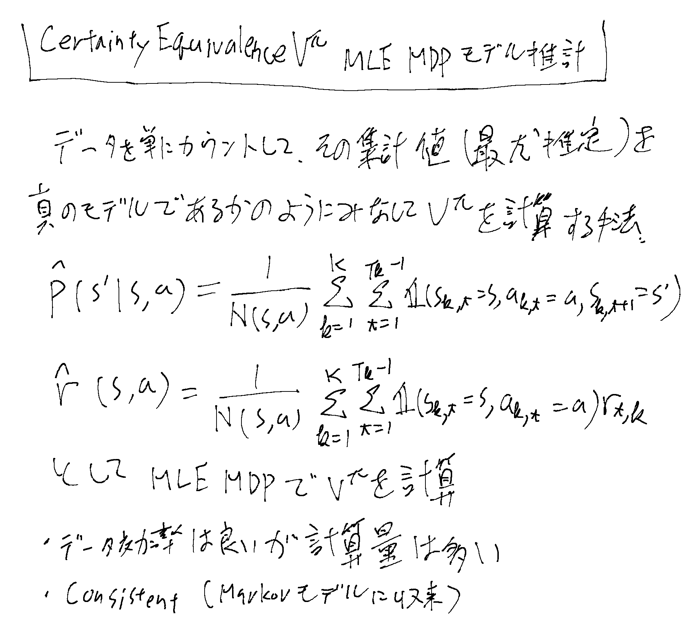

[[ModelFreePolicyEvaluation]]の文脈で、データからモデルを推計する事でモデルありの手法を使う、というアイデア。
モデルやそれが得られた後については[[MarkovDecisionProcess]]と同様の扱いとする。

単純なMLEを真のモデルであるかのように扱って計算する。確率的な扱いをしない。

モデルが得られた後はDynamic Programmingで計算する。（[[MarkovDecisionProcess]]を参照）
