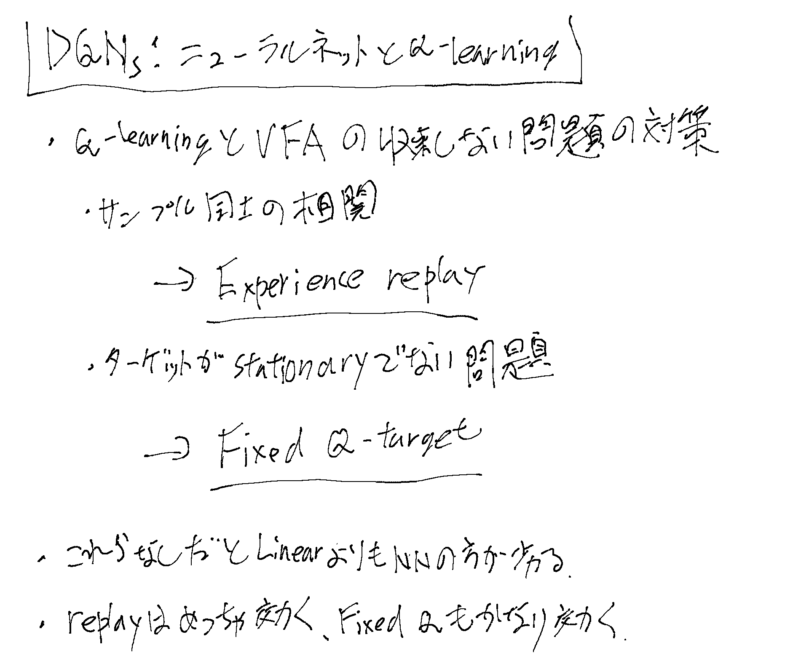
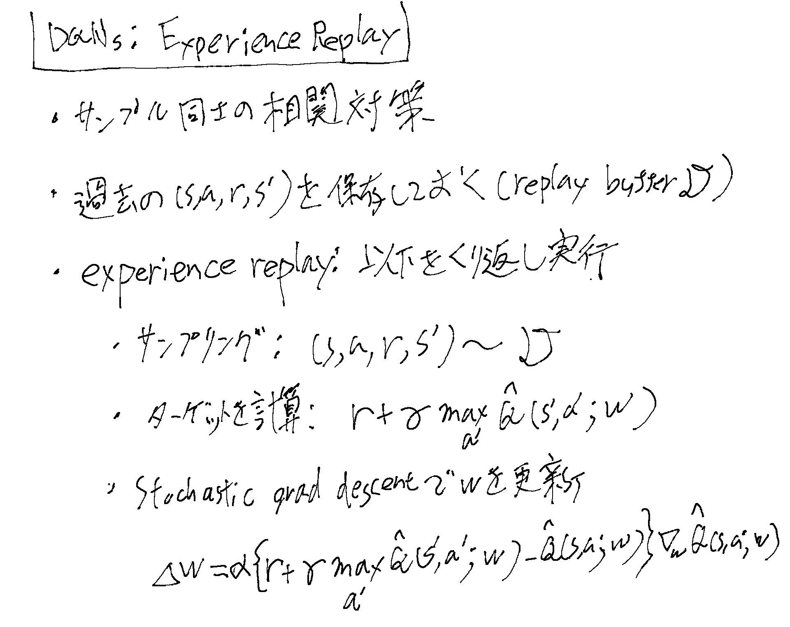
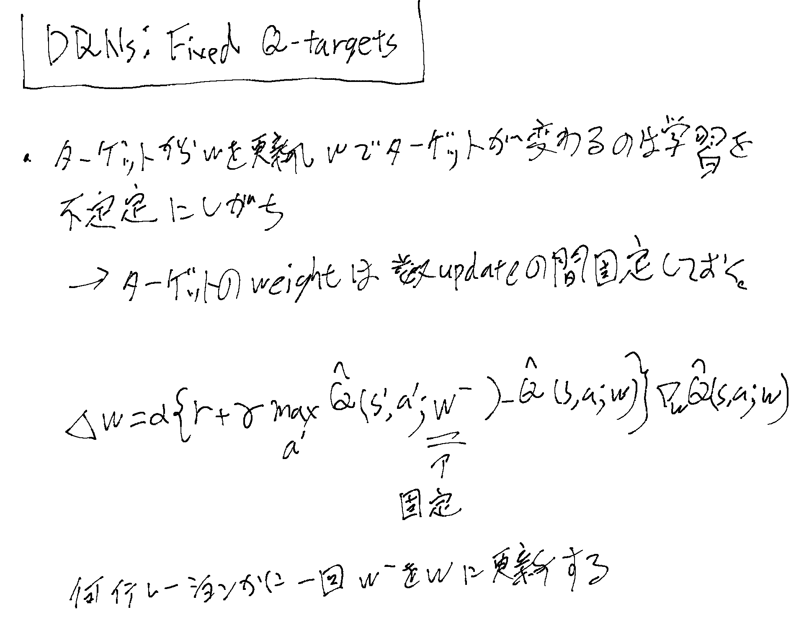

Deep Q-Networks。[[ModelFreePolicyImprovement]]の文脈で、[[Value関数の関数近似]]でニューラルネットを使うものだが、
単に使うとDeadly Triadの問題がでてくるため、工夫した、というもの。Atariでめちゃゲームうまく遊ぶのでみんな驚いた。

## Deadly Triadの二つの対策

ようするに以下の二つが大切。

- Experience replay
- Fixed Q-target

Deadly Triadについては[[Value関数の関数近似]]参照。

## Experience Replay

## Fixed Q-Target

