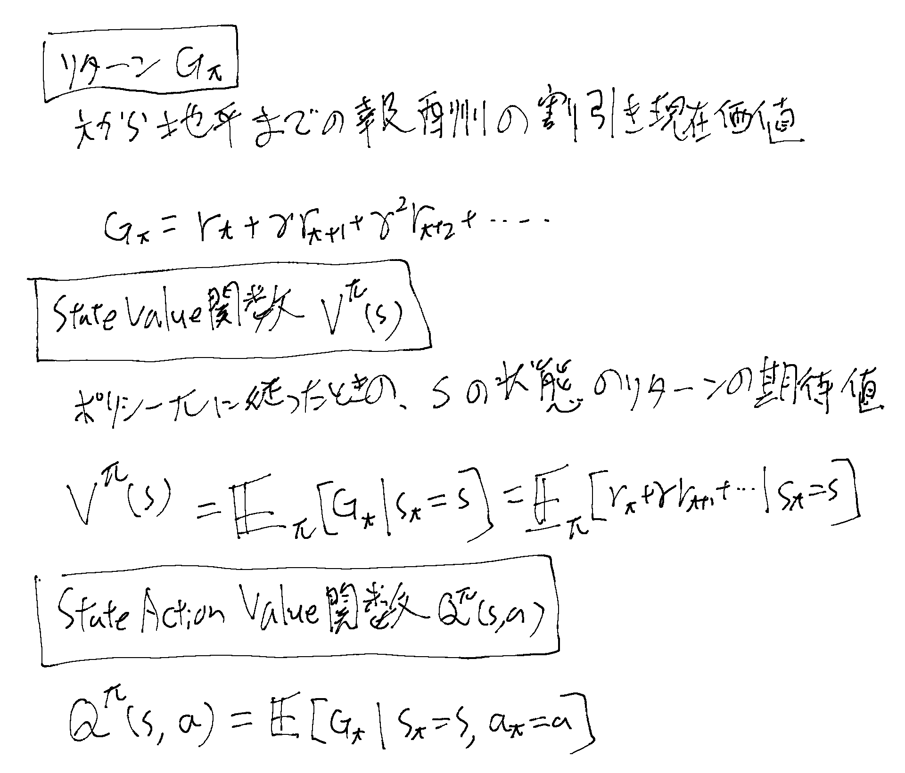

[[強化学習]]のCS234のLecture 3のノート。
dynamicsとrewardsに関するmodelを知らない状態でのpolicy evaluation。

[Stanford CS234 Reinforcement Learning I Policy Evaluation I 2024 I Lecture 3 - YouTube](https://www.youtube.com/watch?v=jjq51TRNVvk&list=PLoROMvodv4rN4wG6Nk6sNpTEbuOSosZdX&index=3)

## 概要

1. モンテカルロ Policy Evaluation
   - First Visit
   - EveryVisit
   - インクリメンタル
2. Temporal Difference Learning
3. Certainty Equivalence with dynamic programming
4. バッチPolicy Evaluation

## 今回の講義の前提

今回の前提としてpolicyはfixedなものが与えられているとする。
このpolicyに対して、環境から得られたデータだけでこのpolicyを評価する。具体的にはなんらかのアルゴリズムをdeployして顧客が実際に何を買ったか、とかそういうシチュエーション。
rewardsは観測は出来るが数式は知らない。

## それぞれの手法の比較の前提

[[強化学習の用語定義]]も参照。

### バイアス、バリアンス、MSE

[[バイアスとバリアンス]]

### Consistent Estimator

[[ConsistentEstimator]]

## モンテカルロPolicy Evaluation

[[モンテカルロPolicyEvaluation]]

## Temporal Difference Learning

[[TDLearning]]

## Certainty Equivalenceとdynamic programming

[[CertaintyEquivalenceによるモデル推計]]

