前回[[ModelFreePolicyEvaluation]]をやったので、次にPolicy Improvementを考えたい。

[Stanford CS234 Reinforcement Learning I Q learning and Function Approximation I 2024 I Lecture 4 - YouTube](https://www.youtube.com/watch?v=b_wvosA70f8&list=PLoROMvodv4rN4wG6Nk6sNpTEbuOSosZdX&index=4)

## Policy Improvementの難しさ

[[ModelFreePolicyEvaluation]]でポリシーの良さを評価する事は出来たが、
そのポリシーを改善していく方法を考えるとそんなに簡単では無い。

[[MarkovDecisionProcess]]の時のPolicy Improvementと同じように考えると、arg maxのQを求めたくなるが、モデルフリーの場合Policy Evaluationで求めたQはまだ試した事が無いactionについては知らないのでarg maxを求められない。

## Exploration

## ε-greedyポリシー

## ε-greedyポリシーでのPolicy Improvementの性質

## ε-greedyポリシーをControlに使う(MC Control)

## GLIEとε-greedyポリシーでのMC Controlの収束

## TDコントロール

[[TDLearning]]ではVを推計したが、Qを推計するにはアクションが必要となる。
良く使われるのは以下の二つ。

1. SARSA（オンポリシー手法の一つ）
2. Q-Learning（オフポリシー手法の一つ）

### SARSAアルゴリズム

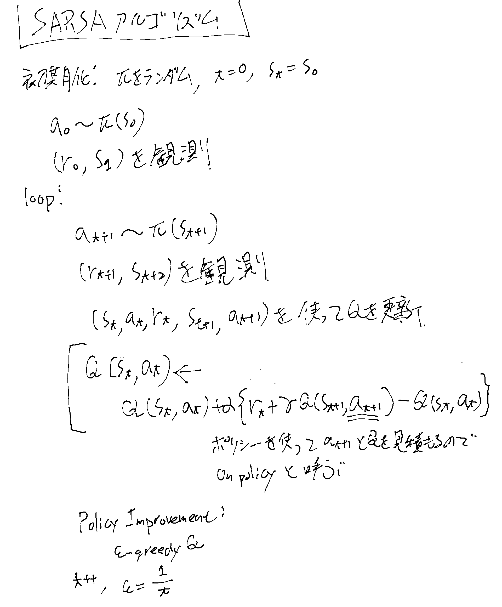

### SARSAの収束の性質

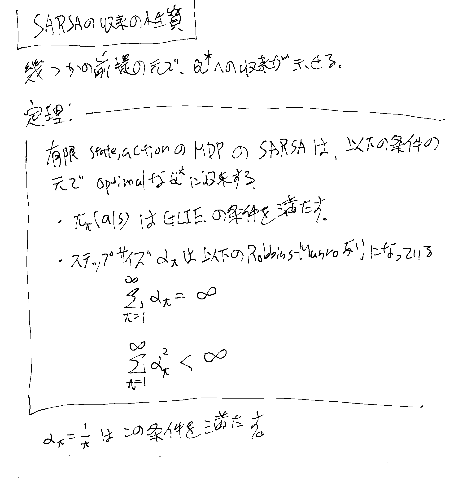

### SARSAの収束の性質に関する研究の経緯

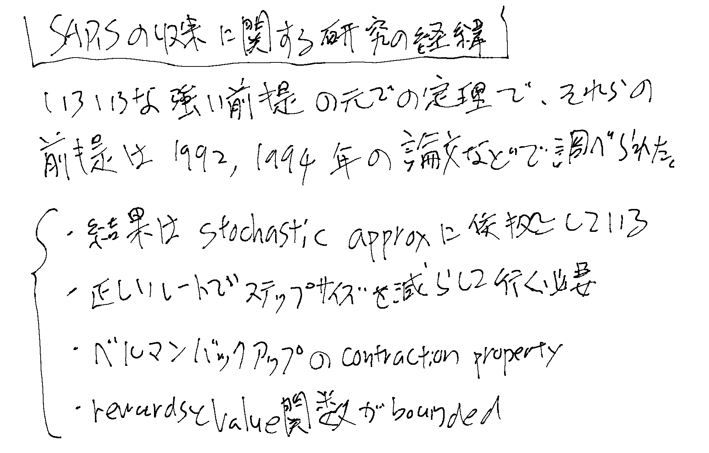

### オンポリシーとオフポリシー

## Q-learning、オフポリシーの手法

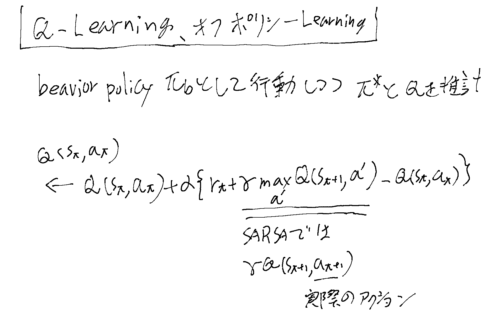

実際のアクションを行うbehaviorポリシーと、Qを推計する時のポリシーが異なり、
QのTDターゲットとする一つ次のstateのQのポリシーはarg max Qとする手法。

## Q-learningでのε-greedyの収束の性質

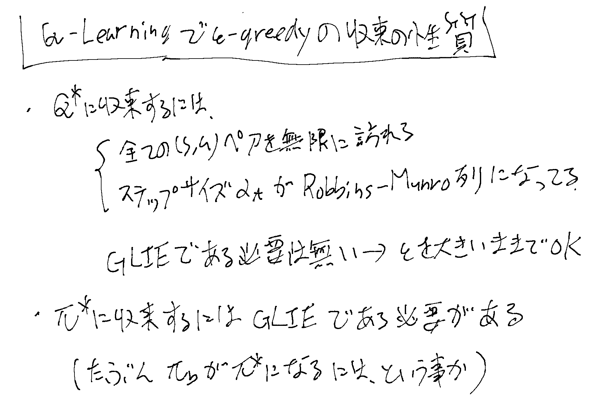

Robbins-Munro列については「SARSAの収束」を参照のこと。

## Value関数の近似（VFA）

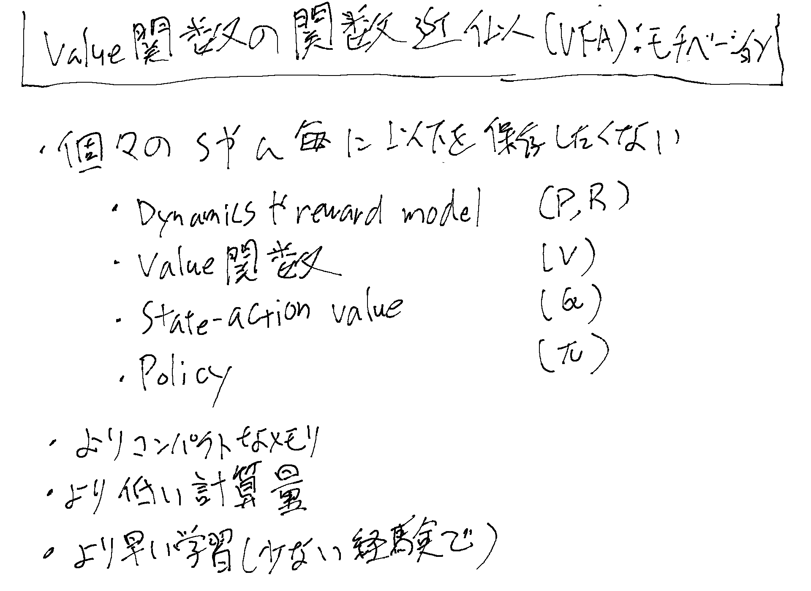
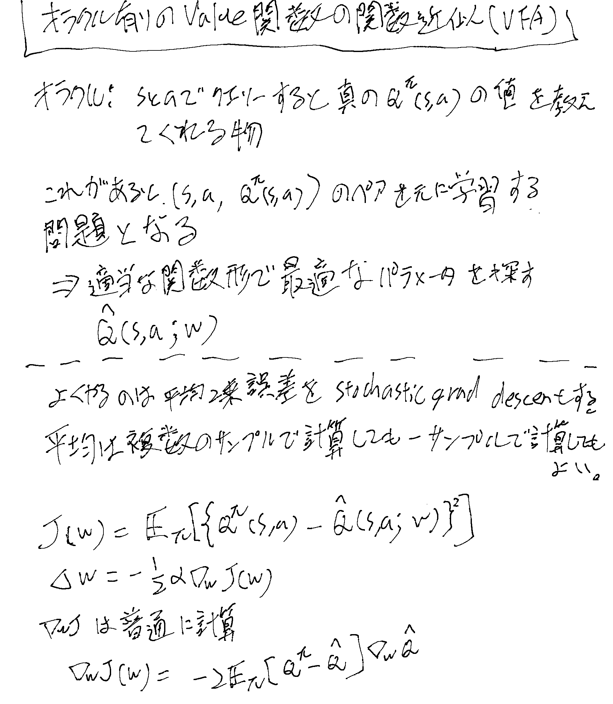
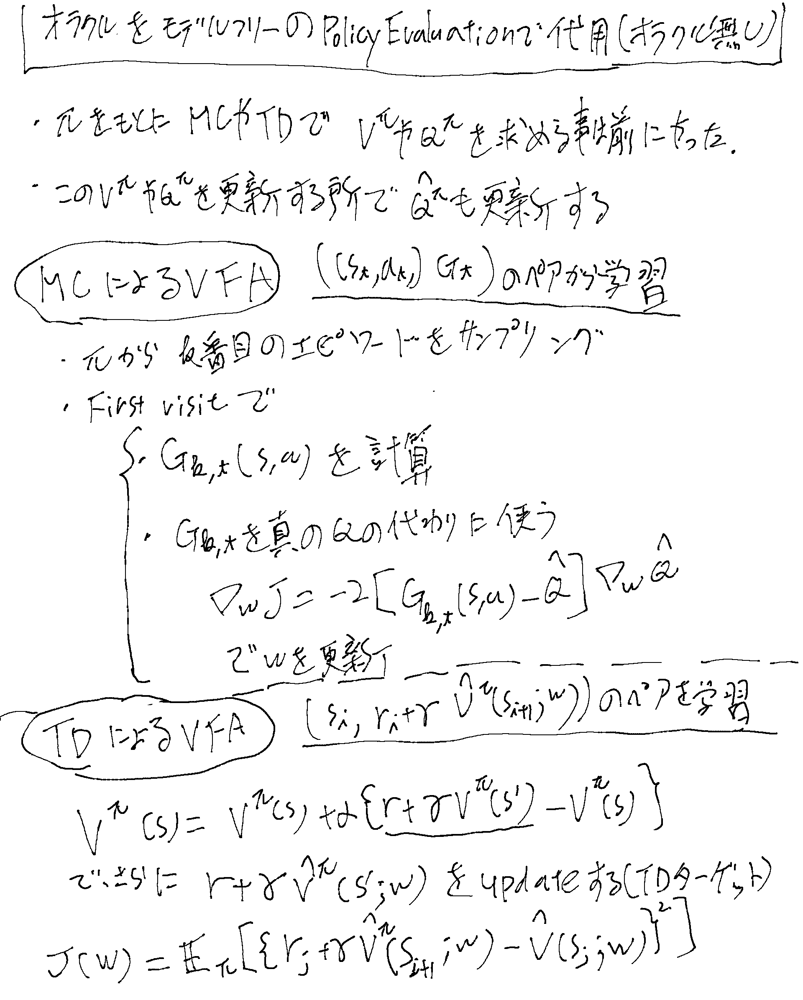
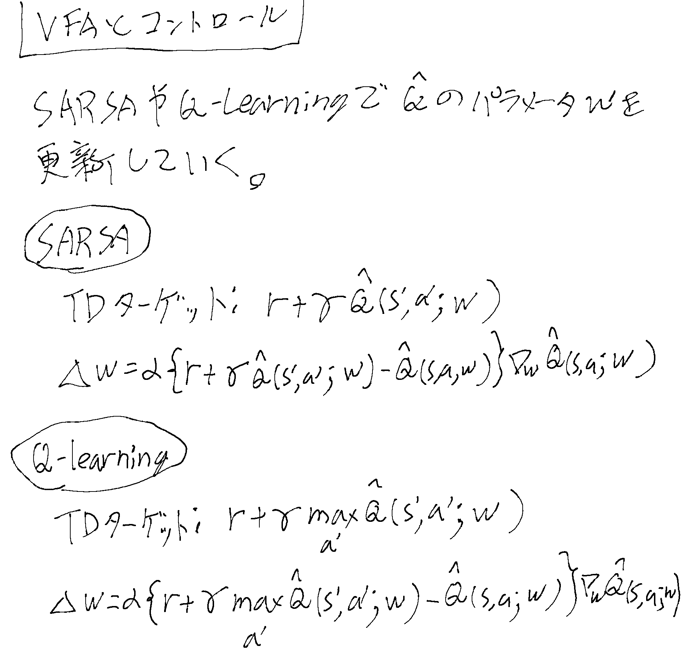
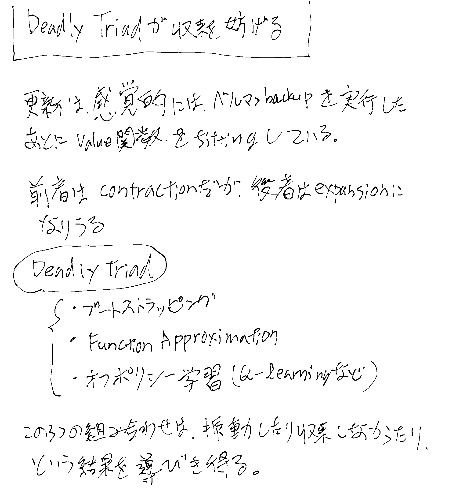
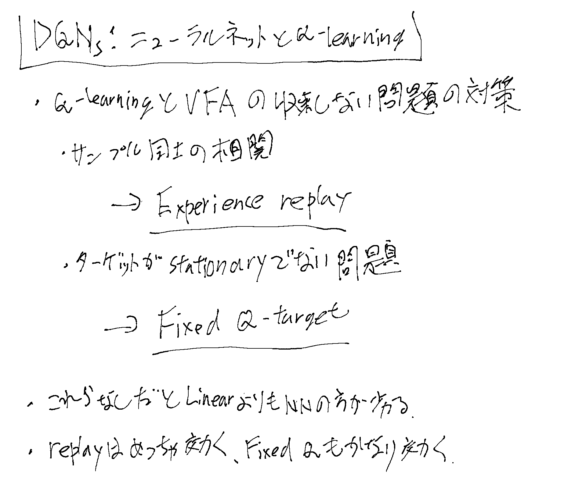
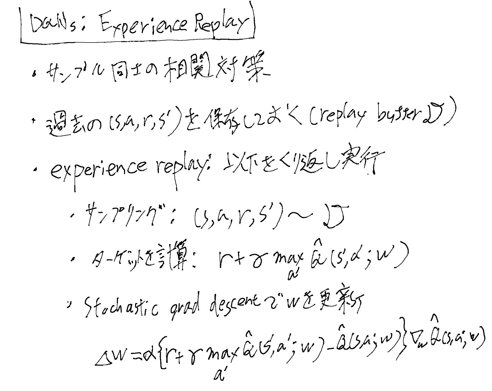
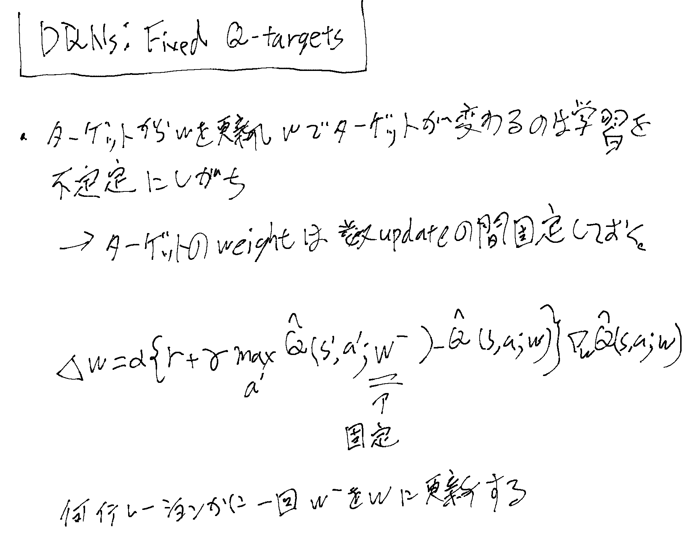