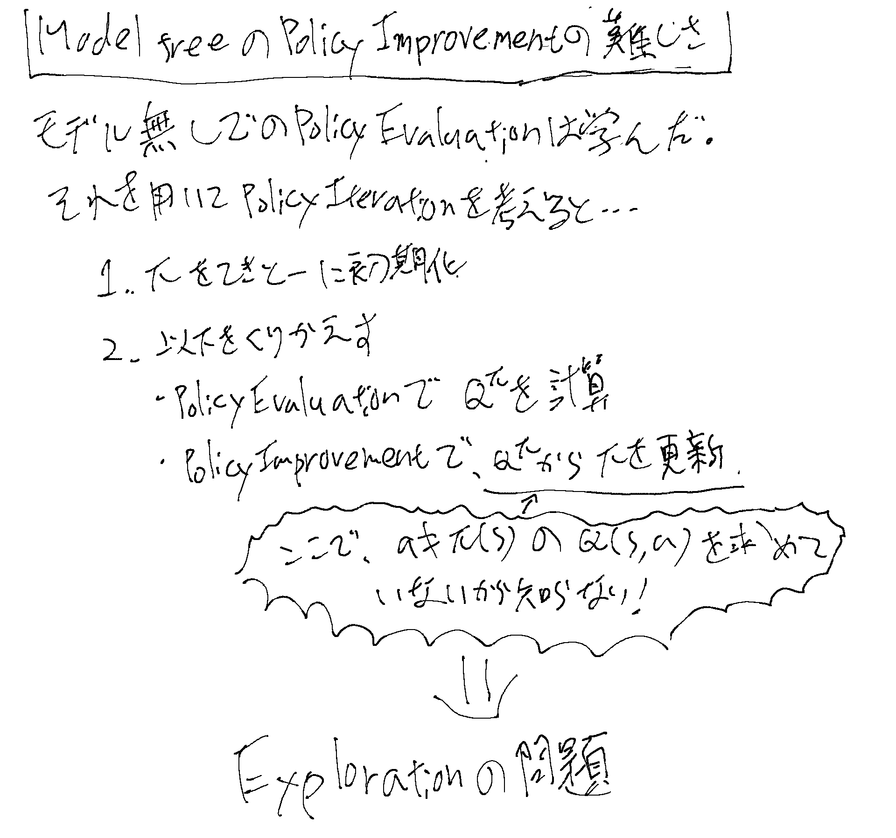
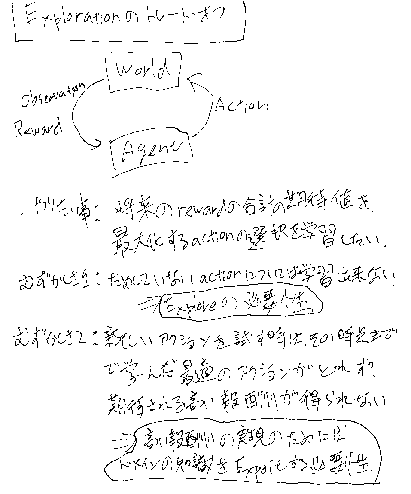
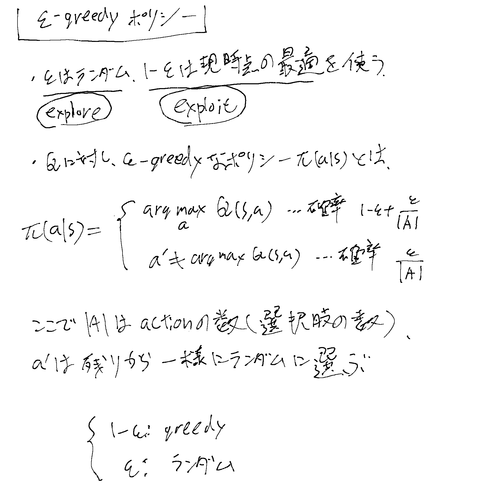
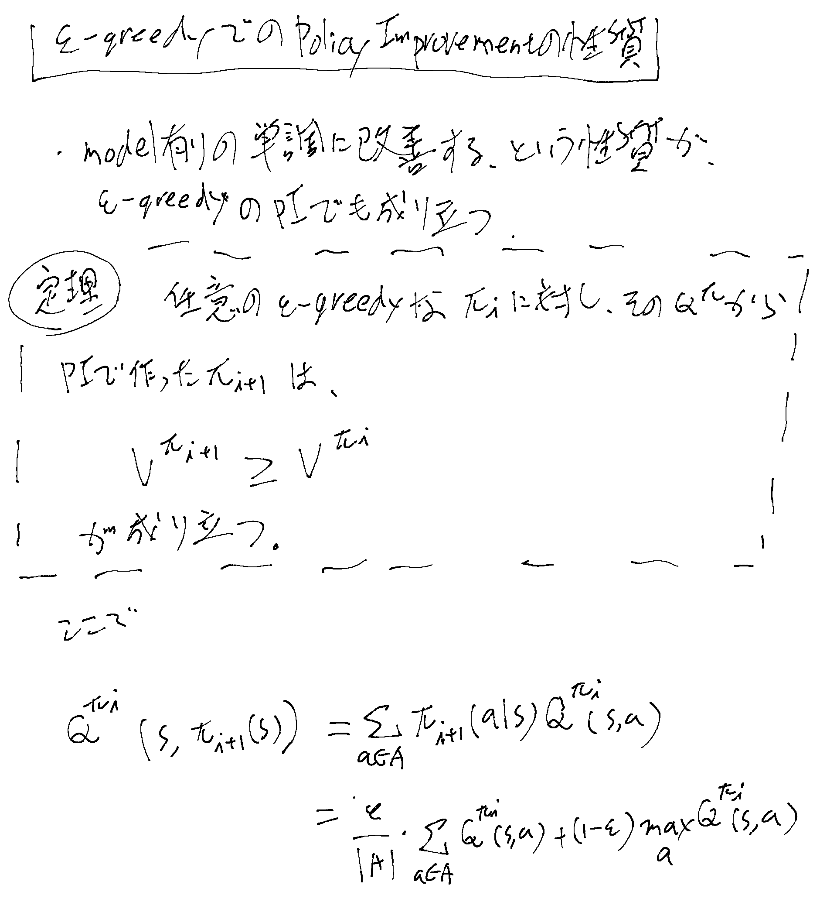
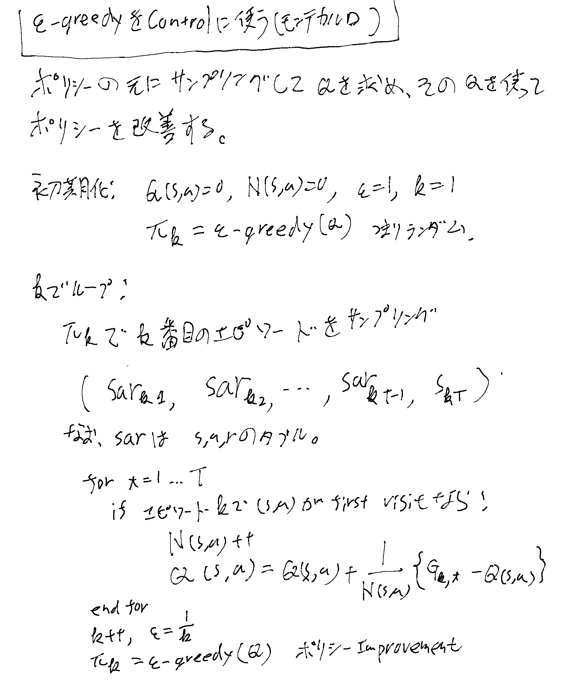
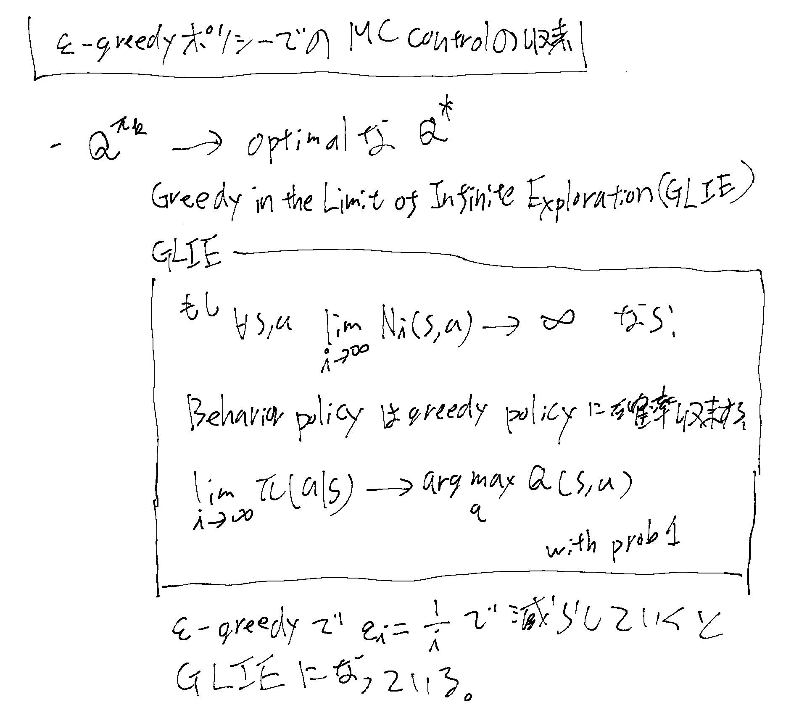
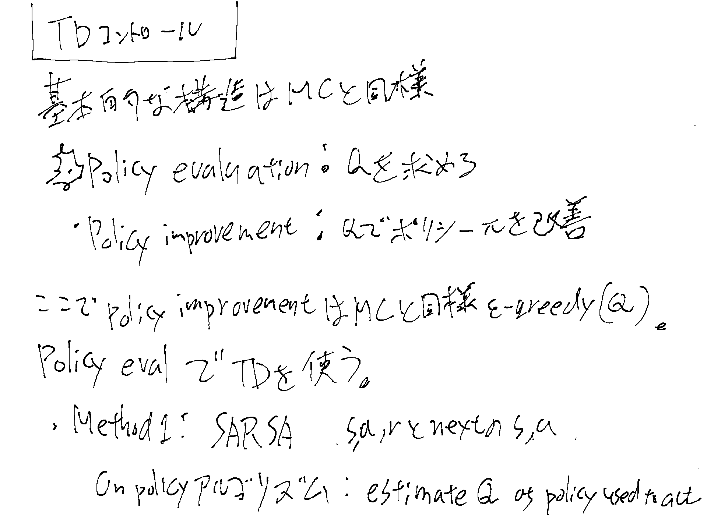
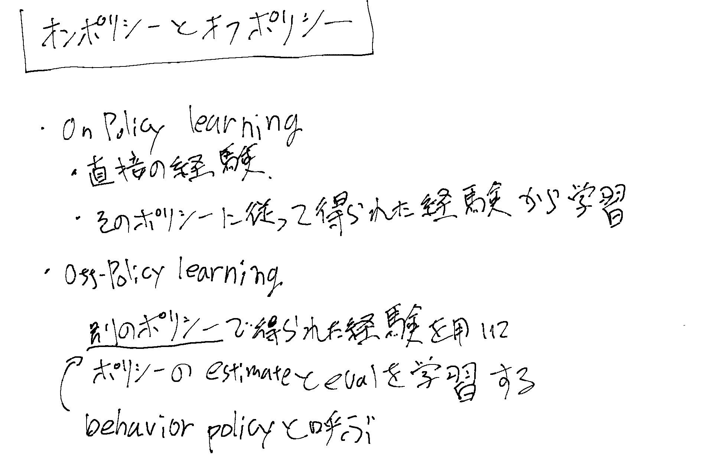

前回[[ModelFreePolicyEvaluation]]をやったので、次にPolicy Improvementを考えたい。

[Stanford CS234 Reinforcement Learning I Q learning and Function Approximation I 2024 I Lecture 4 - YouTube](https://www.youtube.com/watch?v=b_wvosA70f8&list=PLoROMvodv4rN4wG6Nk6sNpTEbuOSosZdX&index=4)

## Policy Improvementの難しさ

[[ModelFreePolicyEvaluation]]でポリシーの良さを評価する事は出来たが、
そのポリシーを改善していく方法を考えるとそんなに簡単では無い。

[[MarkovDecisionProcess]]の時のPolicy Improvementと同じように考えると、arg maxのQを求めたくなるが、モデルフリーの場合Policy Evaluationで求めたQはまだ試した事が無いactionについては知らないのでarg maxを求められない。

## Exploration

## ε-greedyポリシー

## ε-greedyポリシーでのPolicy Improvementの性質

## ε-greedyポリシーをControlに使う(MC Control)

## GLIEとε-greedyポリシーでのMC Controlの収束

## TDコントロール

[[TDLearning]]ではVを推計したが、Qを推計するにはアクションが必要となる。
良く使われるのは以下の二つ。

1. [[SARSA]]（オンポリシー手法の一つ）
2. [[QLearning]]（オフポリシー手法の一つ）

### オンポリシーとオフポリシー

## Value関数の関数近似（VFA）

[[Value関数の関数近似]]
