Proximal Policy Optimizationの略。
[[強化学習]]の[[PolicySearch]]でポリシースペースで離れすぎないように制約を入れたもの。

- [Stanford CS234 Reinforcement Learning I Policy Search 2 I 2024 I Lecture 6 - YouTube](https://www.youtube.com/watch?v=8PwvNQ5WS-o&list=PLoROMvodv4rN4wG6Nk6sNpTEbuOSosZdX&index=6)
- [Stanford CS234 Reinforcement Learning I Policy Search 3 I 2024 I Lecture 7 - YouTube](https://www.youtube.com/watch?v=4ngb0IZTg8I&list=PLoROMvodv4rN4wG6Nk6sNpTEbuOSosZdX&index=7)

Telescoping sum: nまでの和が、それぞれ打ち消し合って最初と最後だけ残るような奴。

## PolicyGradientの振り返りと短所

PPOは[[PolicyGradient]]を改善したものなので、そのモチベーションから見る。

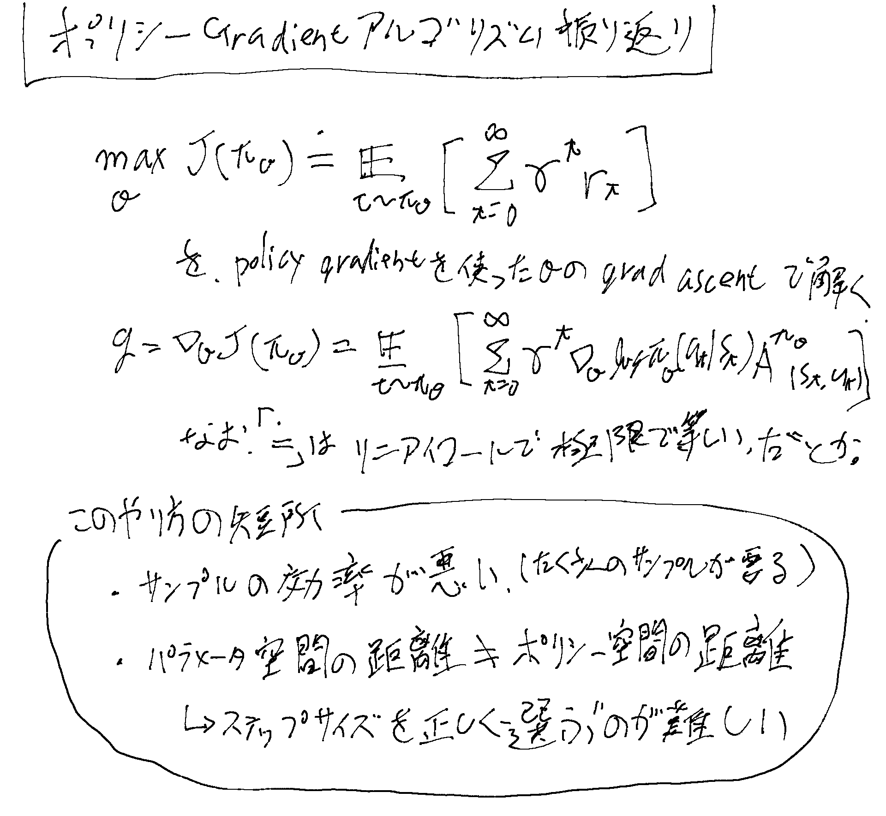

## 二つのポリシーの間のRelative Performance

ポリシー空間での改善を考えるにあたり、二つのポリシーの差分を何らかの形で定義したい。
まず $\pi$ というポリシーから $\pi'$ に改善する時の差として、リワードの差分を考えてみる。

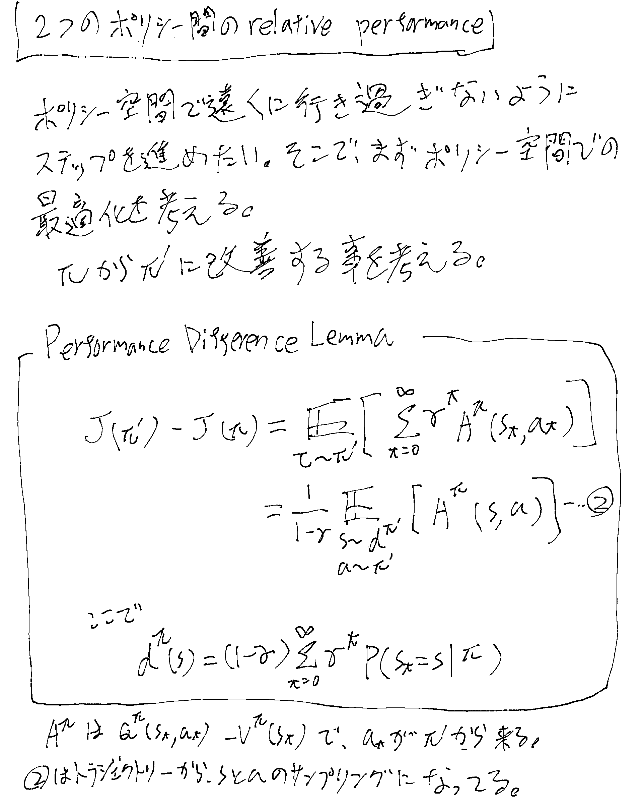

## Relative Policy Performance Bound（ポリシーのデータだけから改善したポリシーを求めたい）

そのまま考えると改善後のポリシーによる期待値が必要になってしまうが、これは未知。
既知のデータである、改善前のポリシーのデータだけで求められないか？

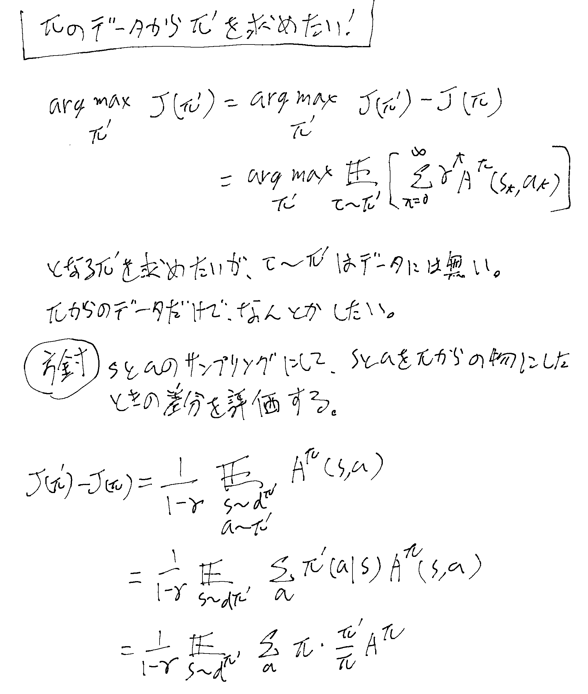
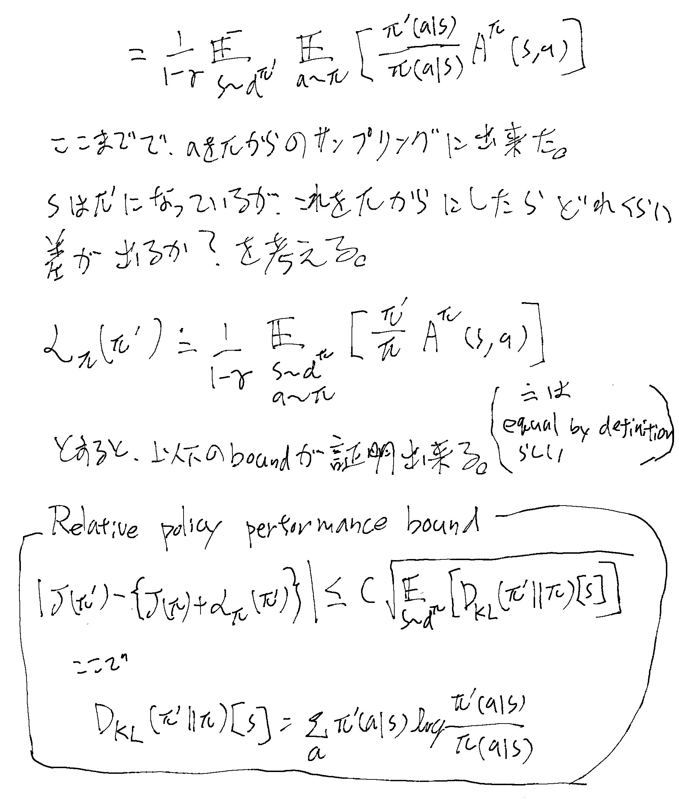

### Relative Policy  Performance Boundの含意

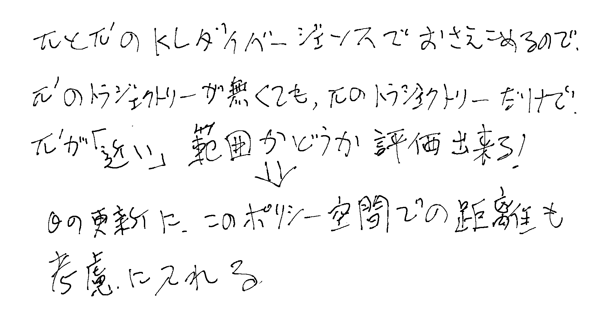

## Proximal Policy Optimization(PPO)

既知のデータの期待値で置き換えた時の誤差はKLダイバージェンスで抑えられる事が分かった。
そこで[[PolicyGradient]]の式に、このKLダイバージェンスの項をregularization的に加えると、
ポリシー空間側で大きく動きすぎない範囲で大きく動かす、という事が期待出来る。

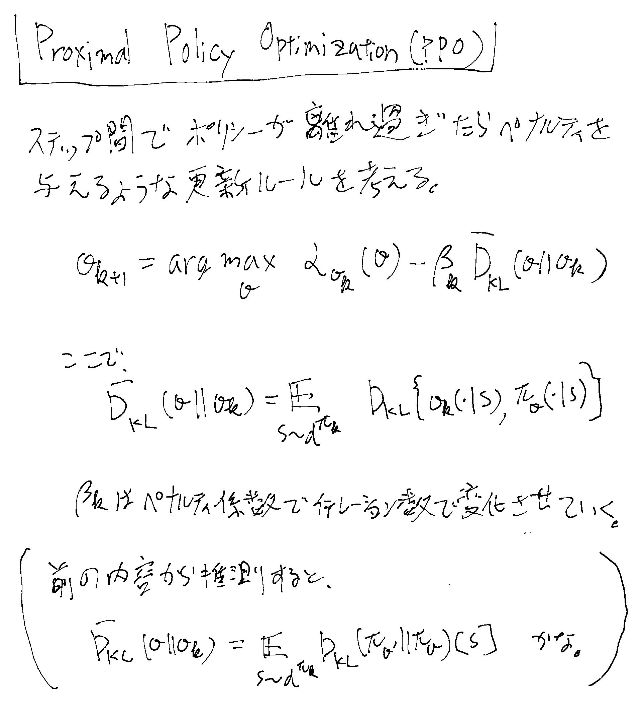

### PPOの派生、Adaptive KLペナルティとClipped Objective

PPOでベータの値をadaptiveに決めていく、というアイデアがAdaptive KLペナルティ。
パラメータを動かす時に、現在のsとaから離れすぎているものは除外するのがClipped Objective。

Clipped Objectiveは簡単な割にはめちゃ有能らしい。

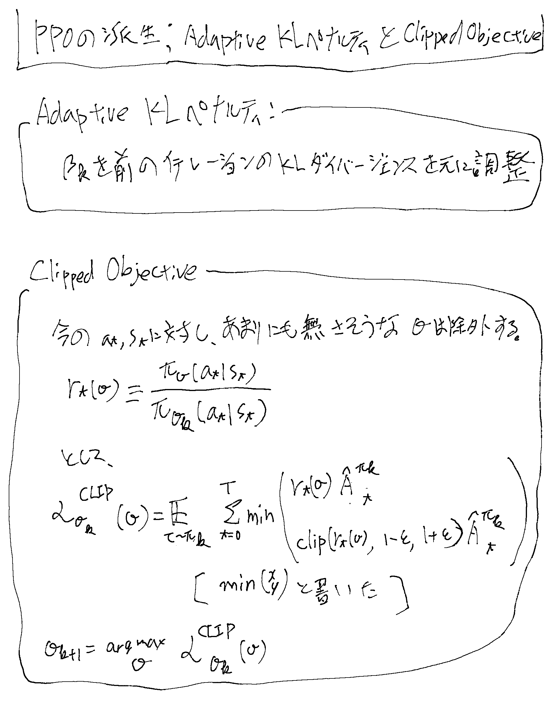
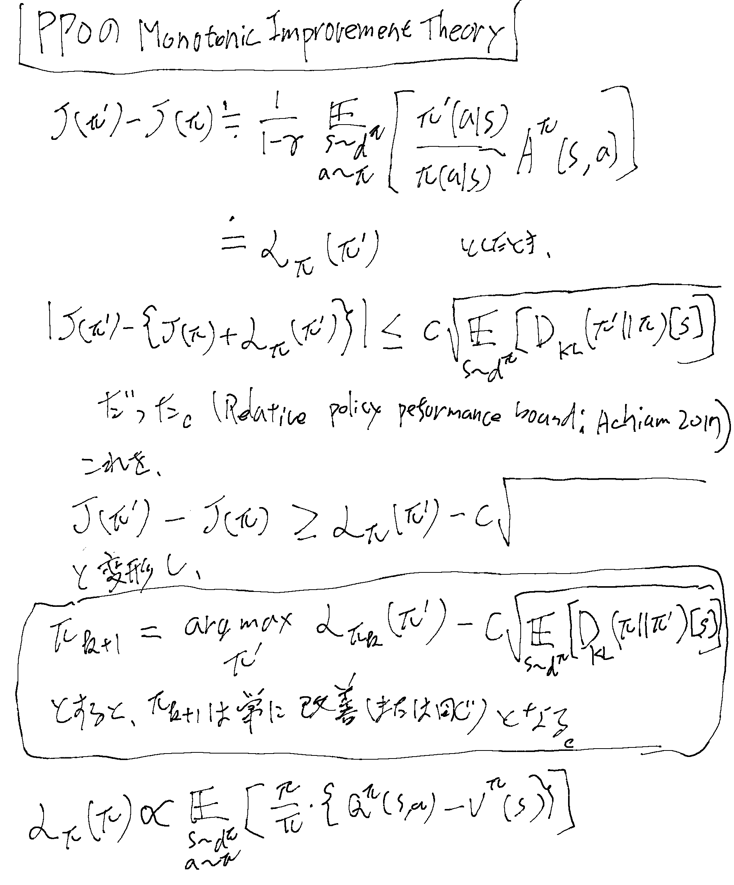
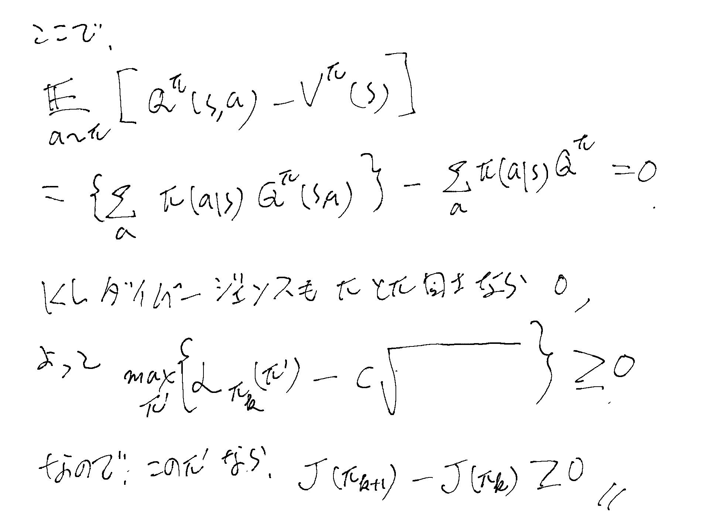
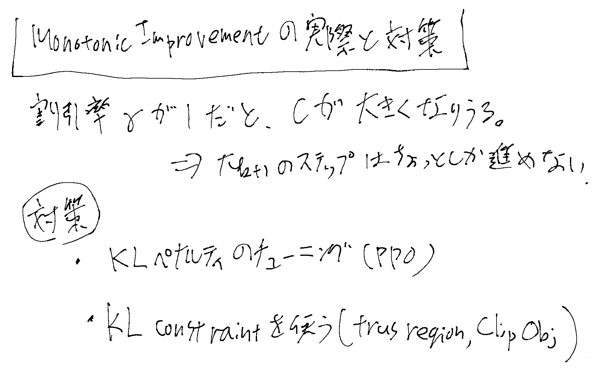
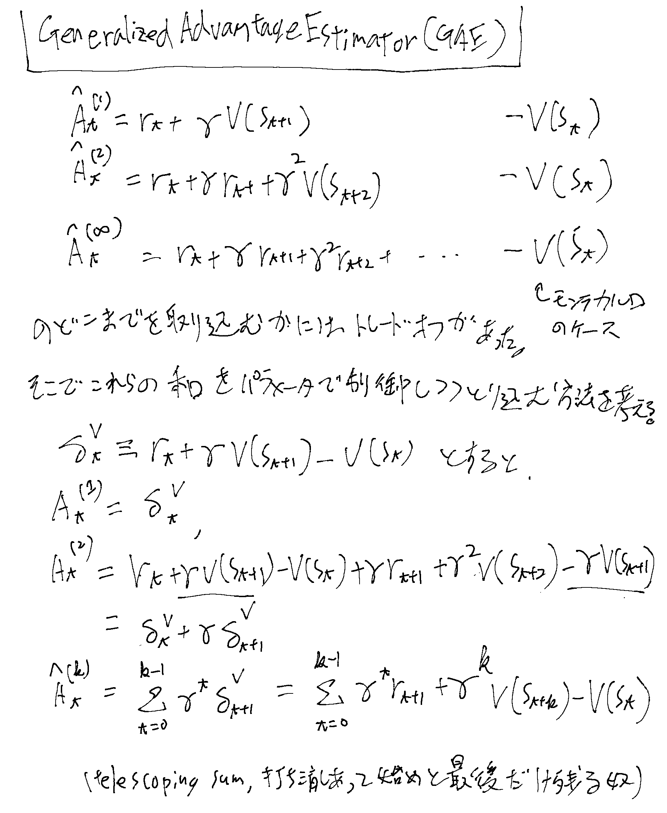
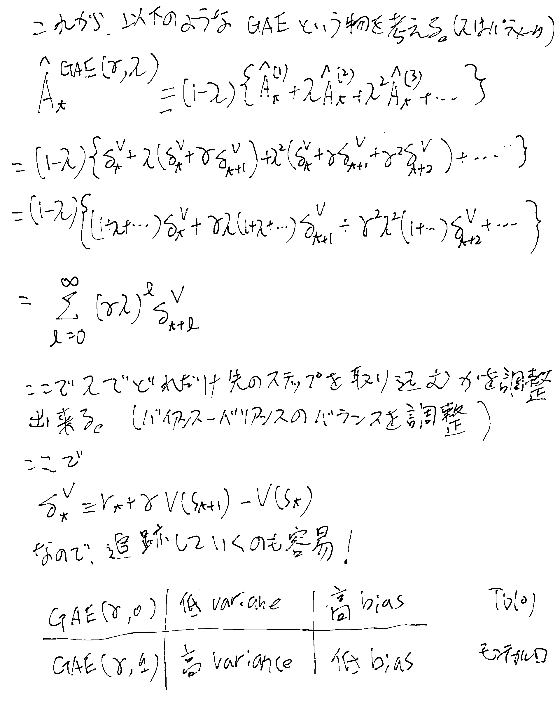

## GAE

High-Dimensional Continuous Control Using Generalized Advantage Estimator (ICLR 2016 by Schulman et al.)

## PPOまとめ

- data efficiencyの改善: 新しいポリシーから追加のデータを集める前に複数のgradient stepを進める場合がある
- monotonic improvementのlikelihoodの改善のためにclipを使ったりする
- 局所最適への収束
- 実装が簡単、ChatGPTなどでも使われてる
