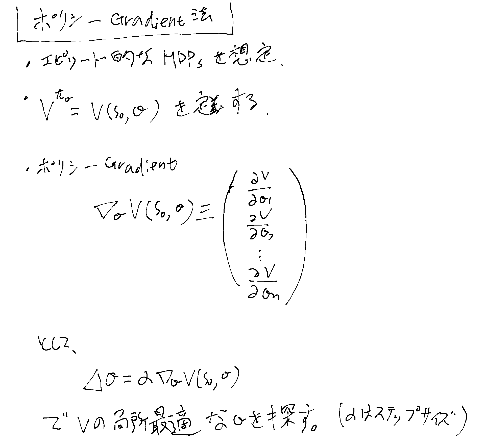
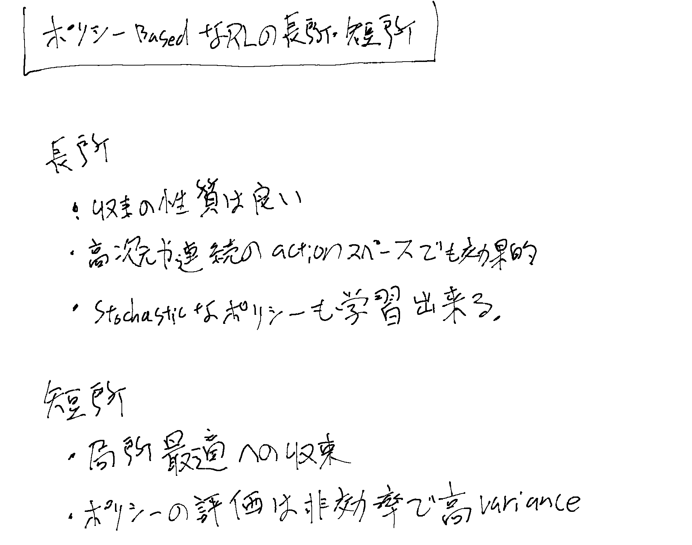
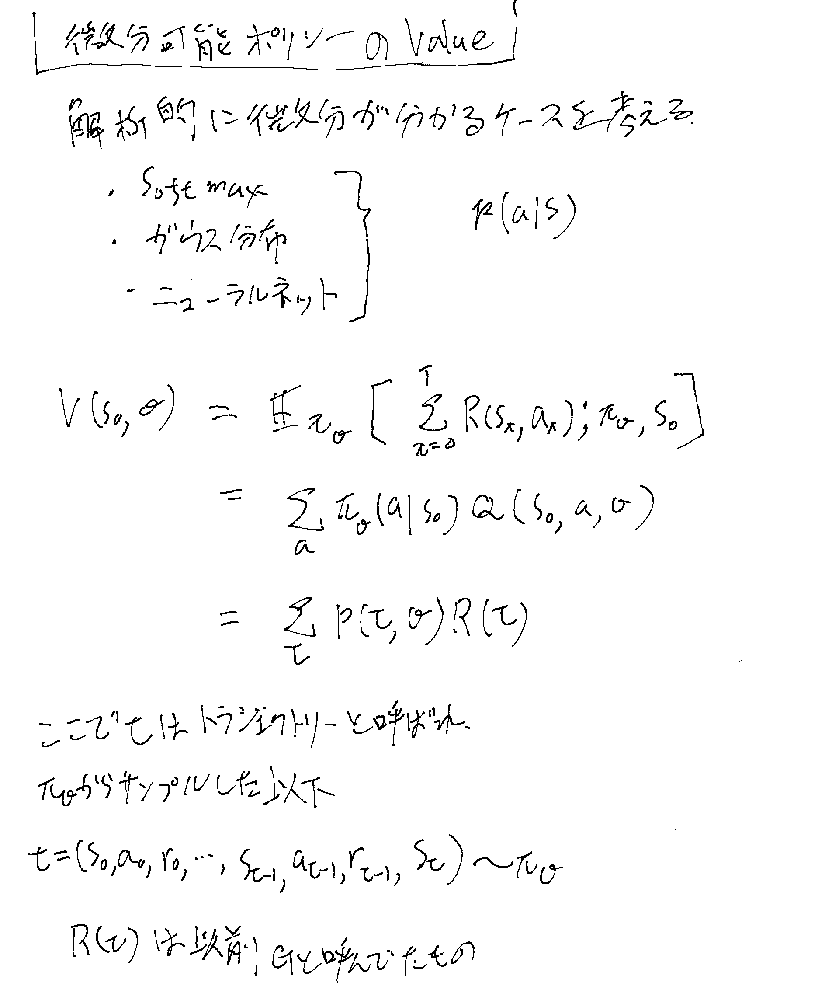
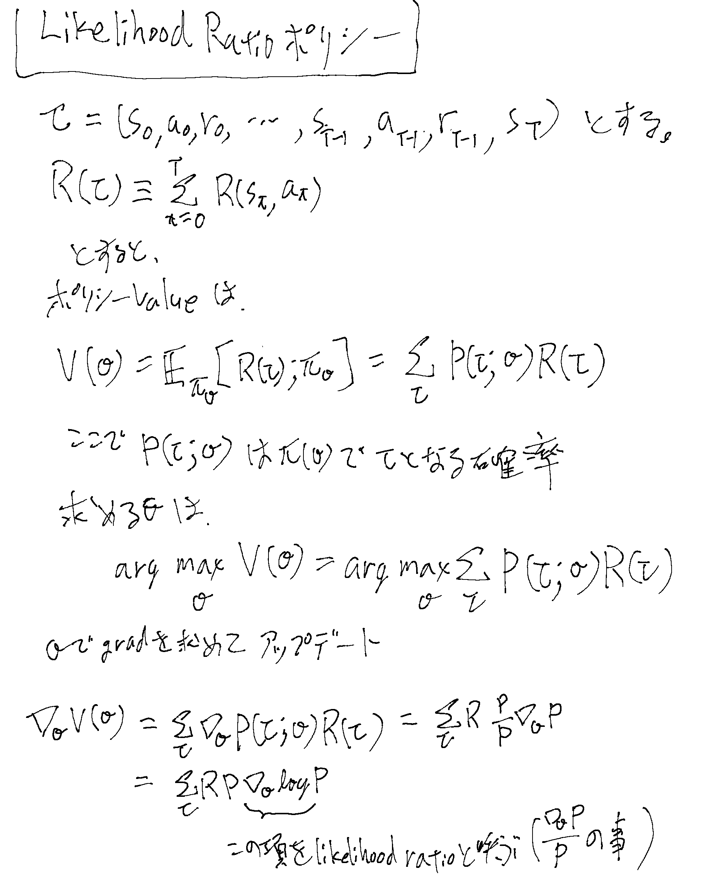
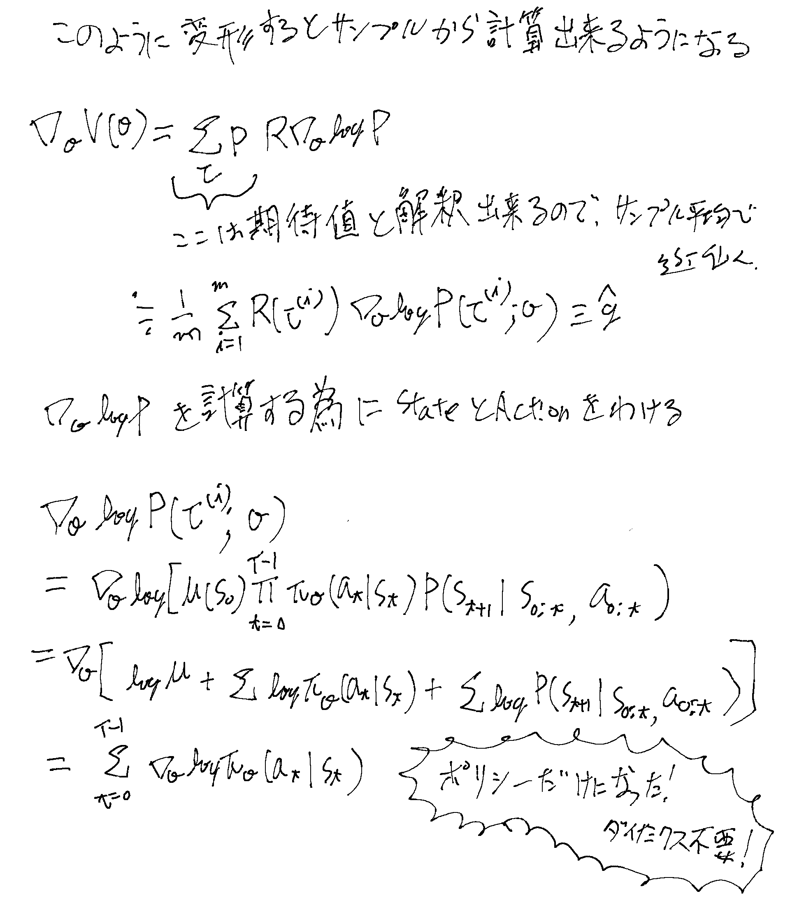
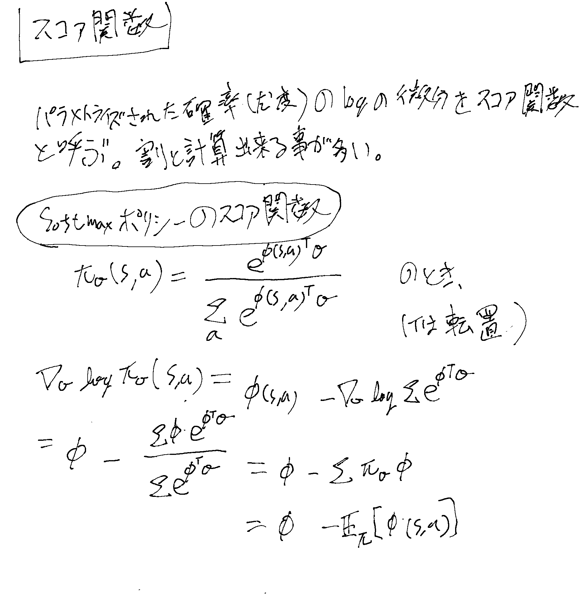
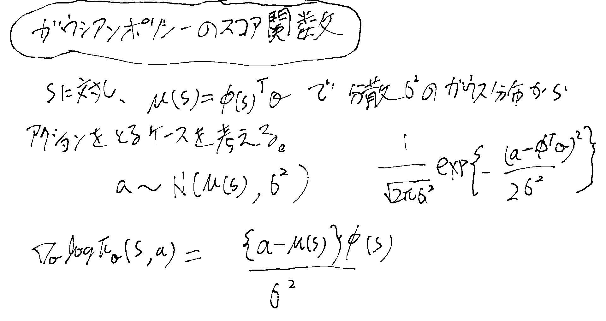
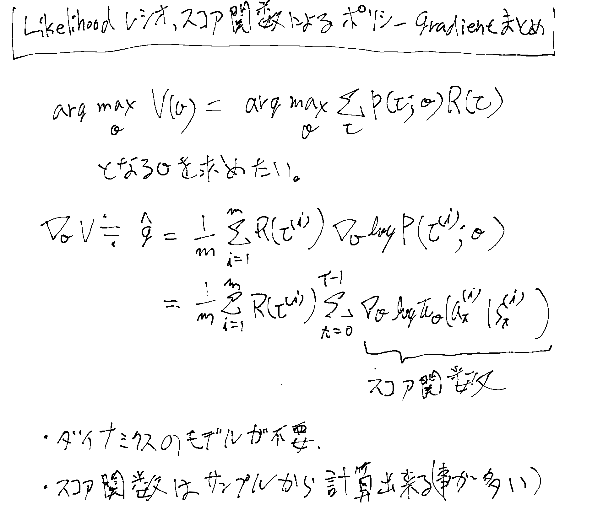
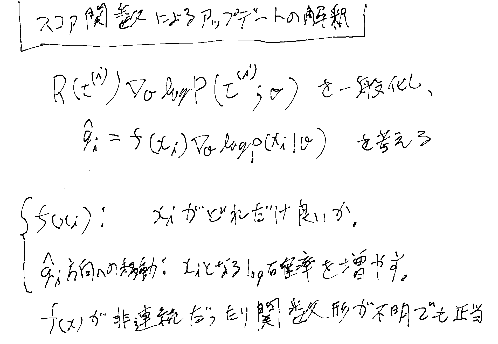
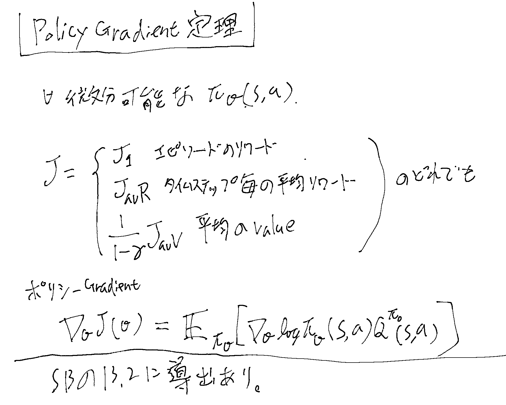

[[強化学習]]の[[PolicySearch]]で、Policy Gradientを使う手法についてまとめる。

## Policy Gradientの手法、一般的な記述

## PolicyベースなRLの、他の手法と比較した特徴

## 微分可能ポリシーとLikelihoodレシオ

ポリシーがパラメータで微分出来る時の事を考える。

### 微分可能ポリシーのValue関数

### Likelihoodレシオによるパラメータ算出

Vからポリシーのパラメータを求めたい。実際に得られるデータから計算出来るように、既知のものだけ残るように計算を試みる。
Vの具体的な形が分かればパラメータで微分してgrad descentすればいいいのだが、Vは分からない。

そこで得られたデータであるリワードなどで書き直して変形していく。

ポリシーとリターンだけの式の期待値になった。

### スコア関数

ポリシーの部分はスコア関数と呼ばれるものの形になっている。likelihood ratioを式変形しただけで同じ式っぽいが。

とにかくスコア関数についていろいろ調べる。

### Likelihoodレシオとスコア関数を用いたPolicy Grad法のまとめ

### スコア関数によるアップデートの解釈

スコア関数を中心にアップデートの式を解釈してみる。

値が良いxを増やすようにパラメータを動かしている、と解釈出来る。

### Policy Gradient定理

ここまでの計算は、より一般的な形で示されている。

## 時系列構造

[[時系列構造を考慮に入れたPolicyGradient法]]

## ポリシー空間での移動幅の制約

[[PPO]]