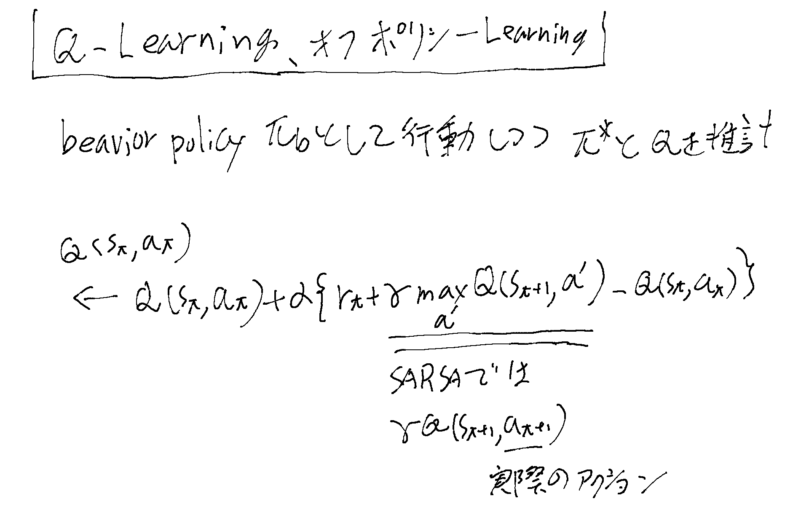
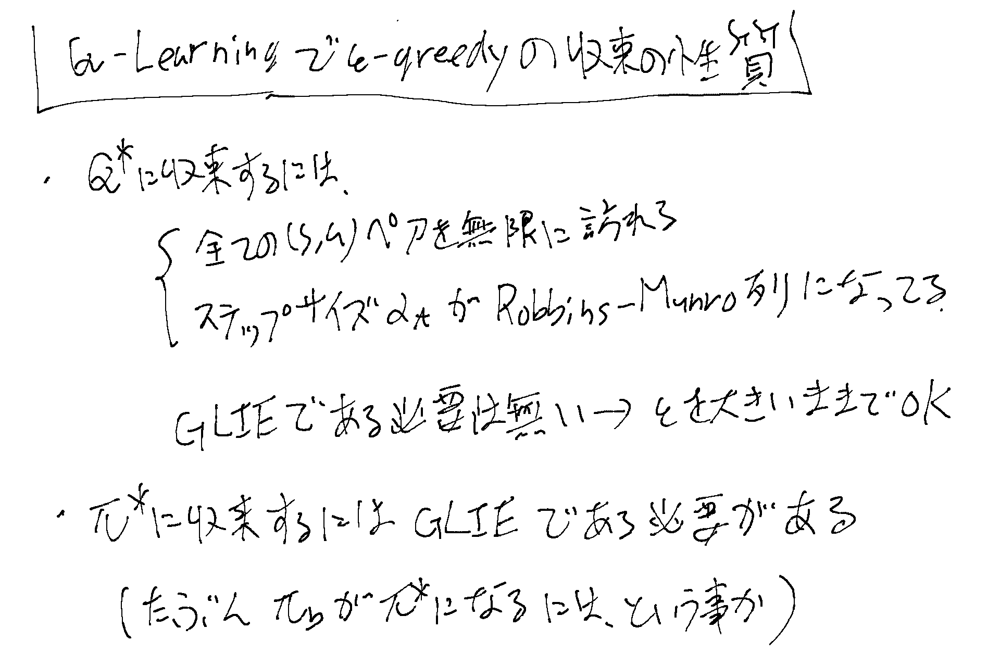

[[強化学習]]の[[ModelFreePolicyImprovement]]で[[TDLearning]]を使う時のオフポリシーの手法。

## Q-learningとは

実際のアクションを行うbehaviorポリシーと、Qを推計する時のポリシーが異なり、
QのTDターゲットとする一つ次のstateのQのポリシーはarg max Qとする手法。

## ε-greedyの収束の性質

Robbins-Munro列については[[SARSA]]の「収束の性質」を参照のこと。

