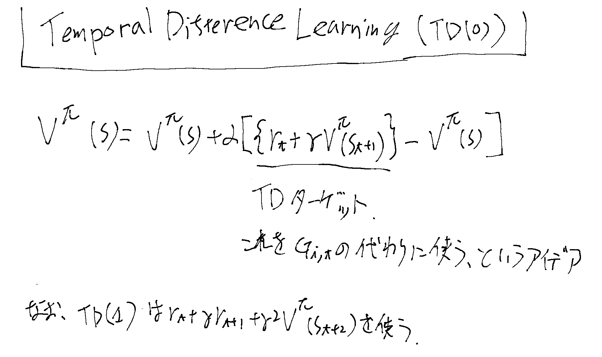
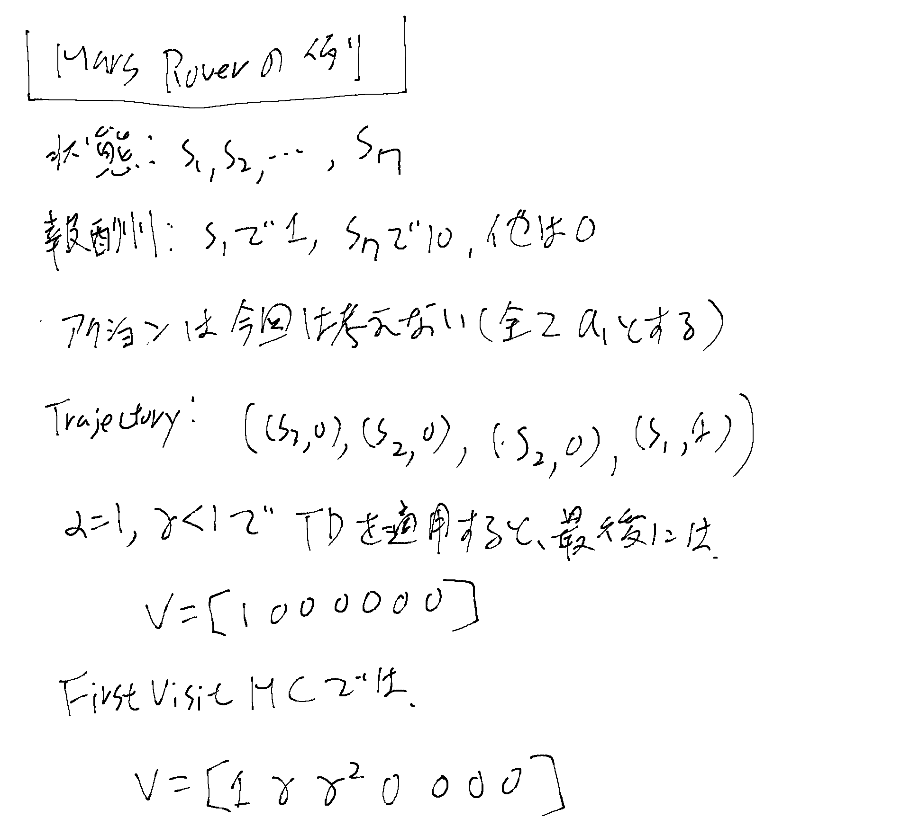

Temporal Difference Learningとも言う。[[ModelFreePolicyEvaluation]]の一種。

## TD Learningとは

つまりGの見積もりとしてエピソード全体を使うのでは無く、そこまでの推計のVと今回のrewardsを組み合わせたものを使う。
１期のrewardsしか使っていない事に注目。（[[モンテカルロPolicyEvaluation]]のインクリメンタルとの違い）

## Mars Roverでの例

## 特徴など

- モンテカルロとdynamic programmingのハイブリッド的なもの
- ブートストラップとサンプリング（最初に幾つかのサンプルでVを推計する）
- 有限地平で無くても使える（エピソード的なセッティングじゃなくてもOK）
- (s, a, r, s')のタプルが来るごとにその場で更新
- 最初の頃は初期化によるのでbiasedなestimator
- インクリメンタルな[[モンテカルロPolicyEvaluation]]と同じ条件で[[ConsistentEstimator]]になる
- [[モンテカルロPolicyEvaluation]]よりvarianceが低い
