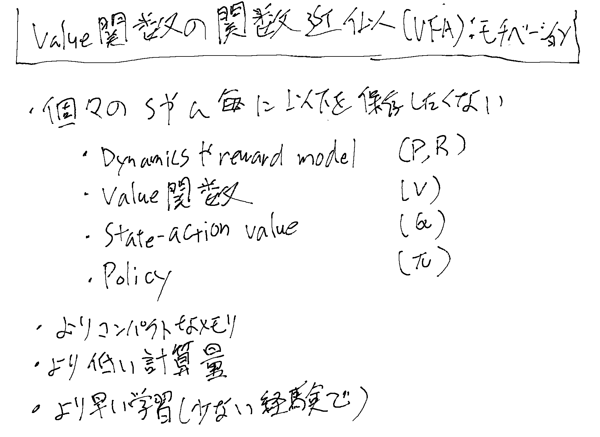
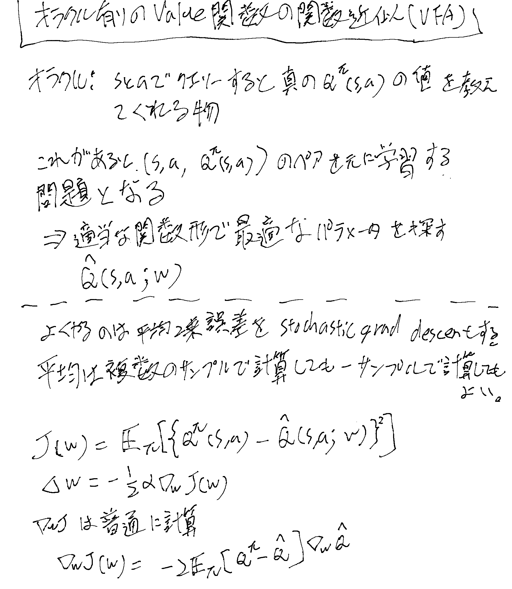
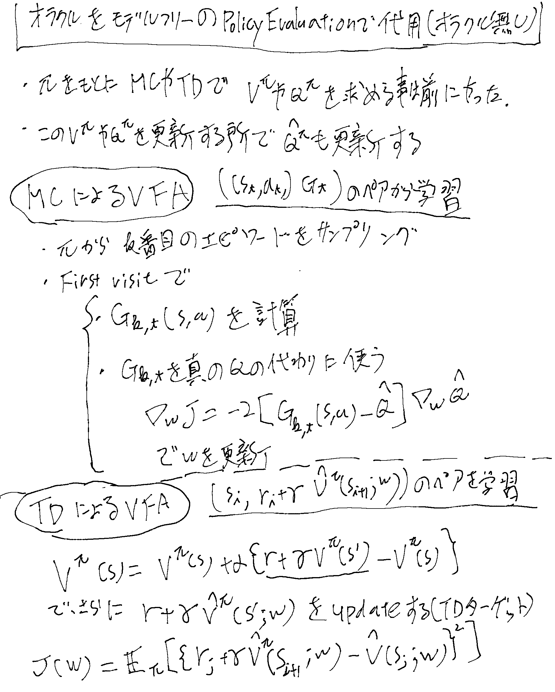
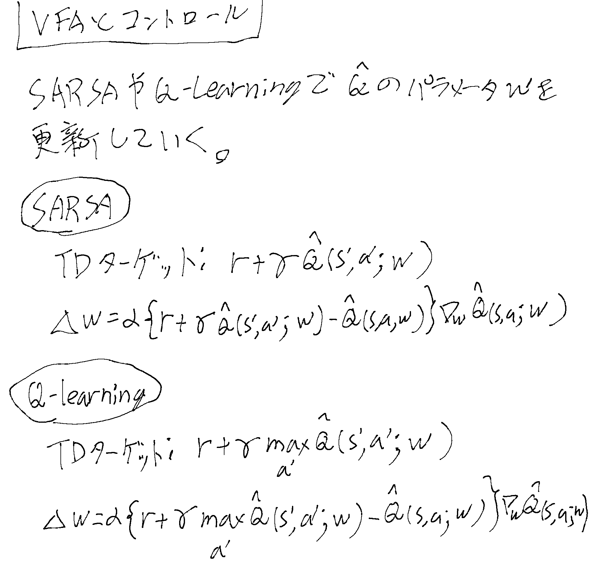
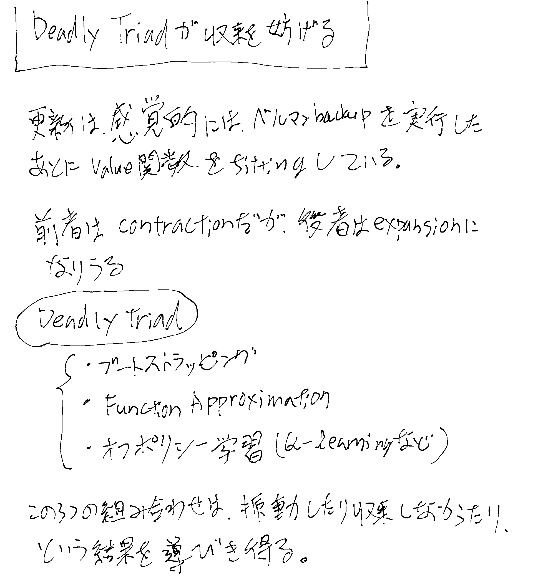

[[ModelFreePolicyImprovement]]より。Value Function ApproximationでVFA。

## モチベーション

## オラクルありのケース

## オラクルをModel FreeのPolicy Evaluationで代用

[[ModelFreePolicyEvaluation]]でやったMCとTDをオラクルの代わりに使う。

TDでVFAする時にQでは無くVを学習しているのは、TDのケースではTD targetsの作り方にMCよりも自由度があっていろいろなケースが考えられるので、
まずはVを学習する話をしている。

## VFAとコントロール

[[SARSA]]や[[QLearning]]でTDターゲットを作り、通常のMSEの最小化で更新していく。

## Deadly Triadが収束を妨げる

## DQNs

[[DQN]]
