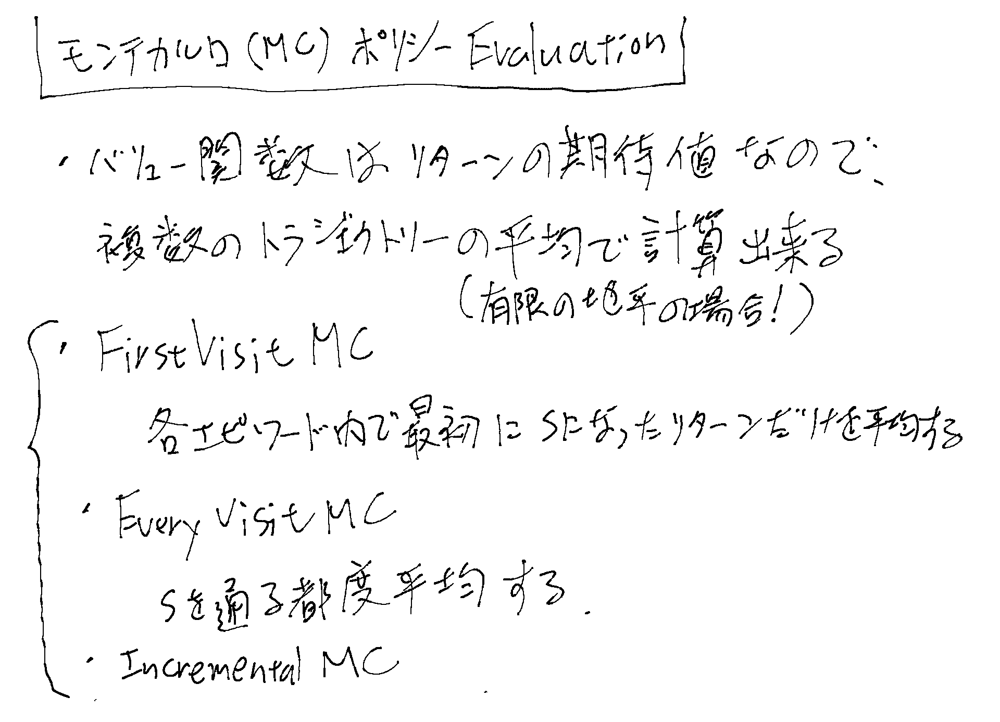
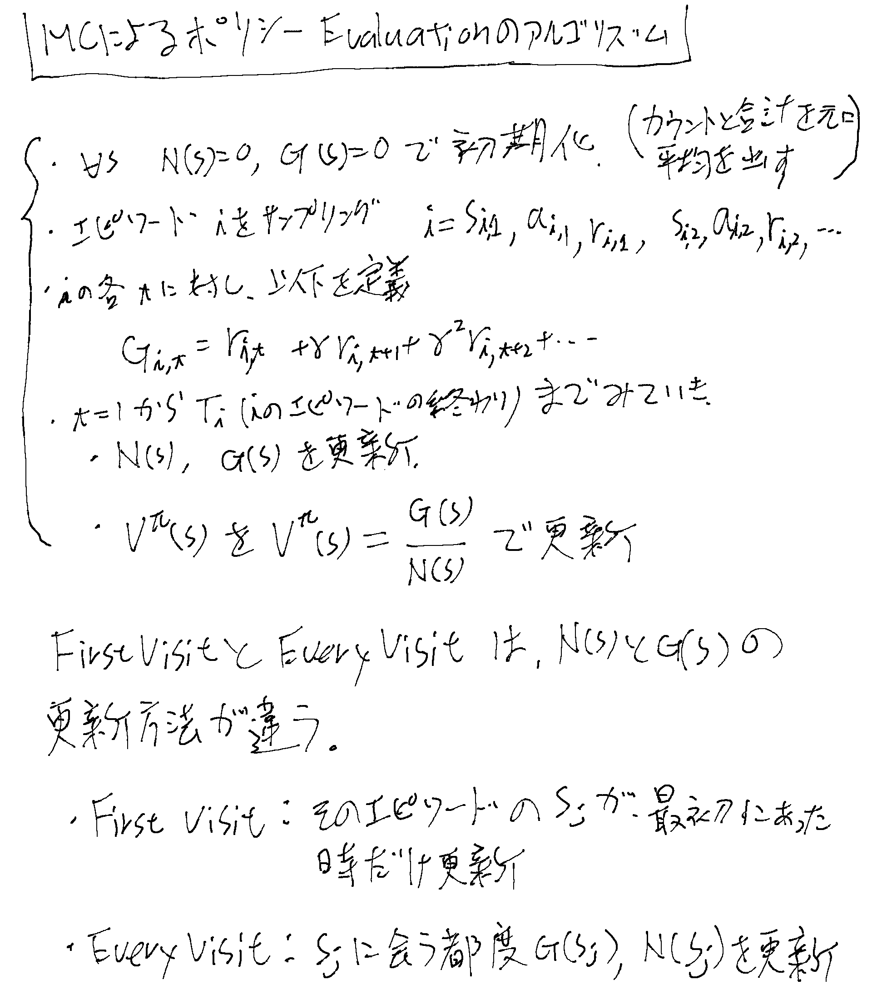
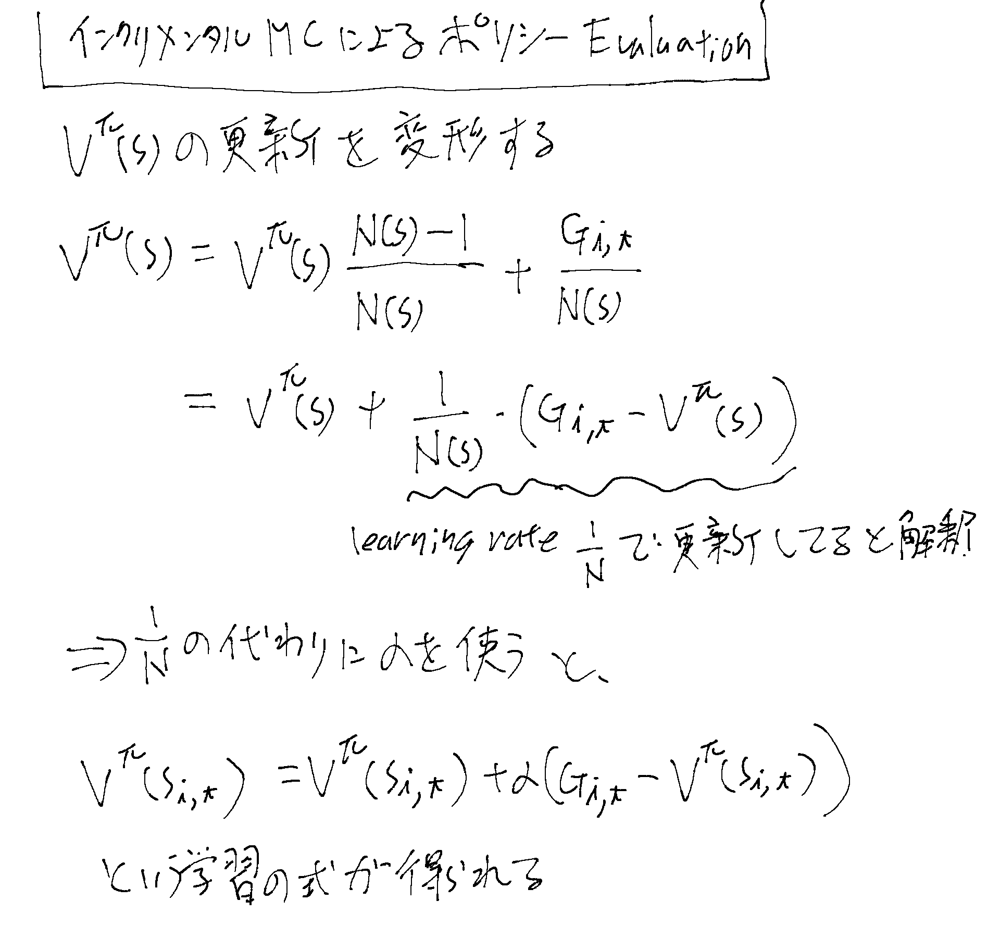
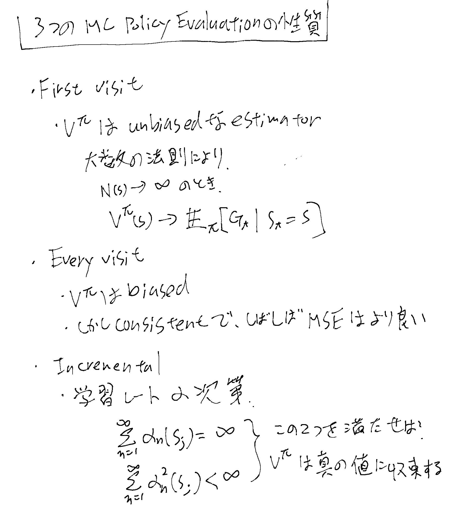
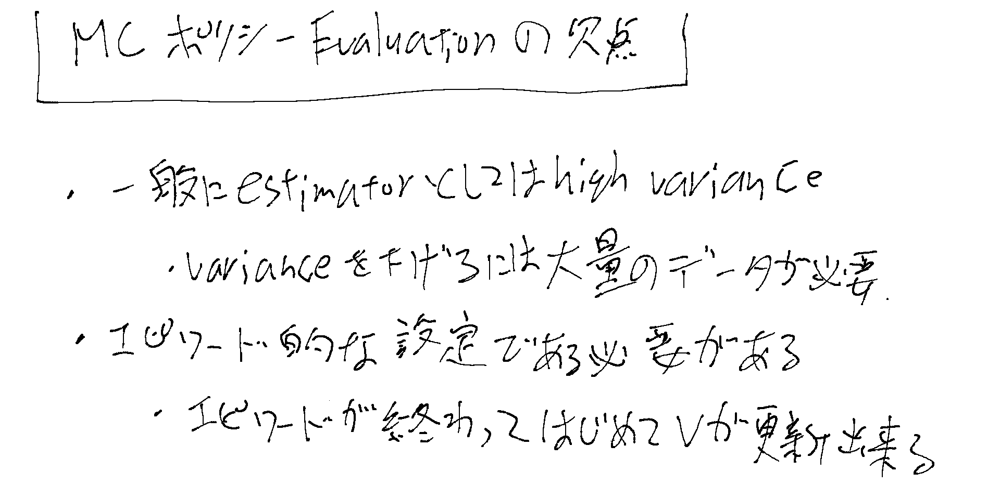

[[ModelFreePolicyEvaluation]]の一種。[[強化学習]]。[[TDLearning]]、[[CertaintyEquivalenceによるモデル推計]]。

[Stanford CS234 Reinforcement Learning I Policy Evaluation I 2024 I Lecture 3 - YouTube](https://www.youtube.com/watch?v=jjq51TRNVvk&list=PLoROMvodv4rN4wG6Nk6sNpTEbuOSosZdX&index=3)

## MC Policy Evaluationとは

エピソードをサンプリングしてVを更新、を繰り返す。
エピソード単位でないと使えない。

## アルゴリズムとFirstVisitとEveryVisitの違い

### インクリメンタル

エピソードをサンプルして$G_{i, t}$を定義する所までは変わらない。

各エピソードiのタイプステップtで、sに遭遇する都度Vを更新する。

という事で1/Nを使ってもいいがそれにこだわらず、一般にラーニングレートのαならなんでも使って良い。

## 3つの手法の比較

Consistentについては[[ConsistentEstimator]]を参照のこと。

## モンテカルロPolicy Evaluationの欠点

[[バイアスとバリアンス]]も参照。[[TDLearning]]とも比較したい。