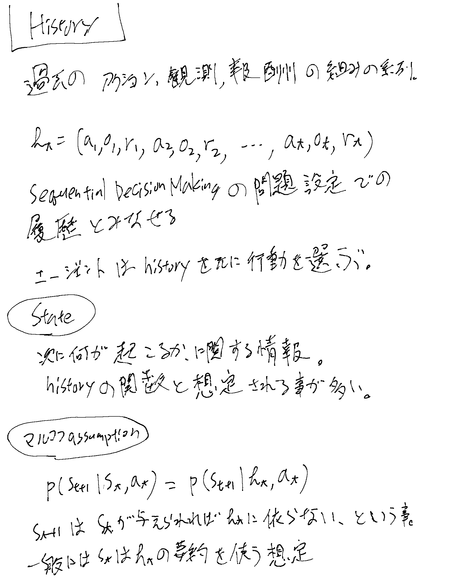
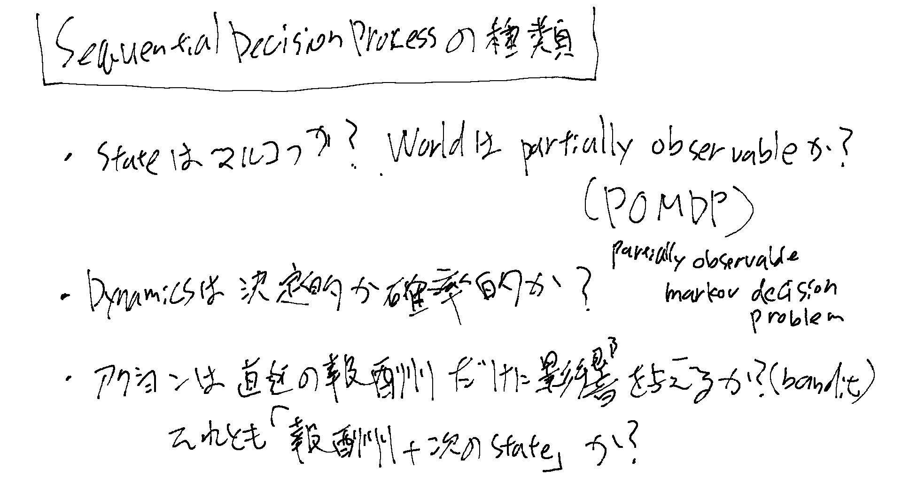
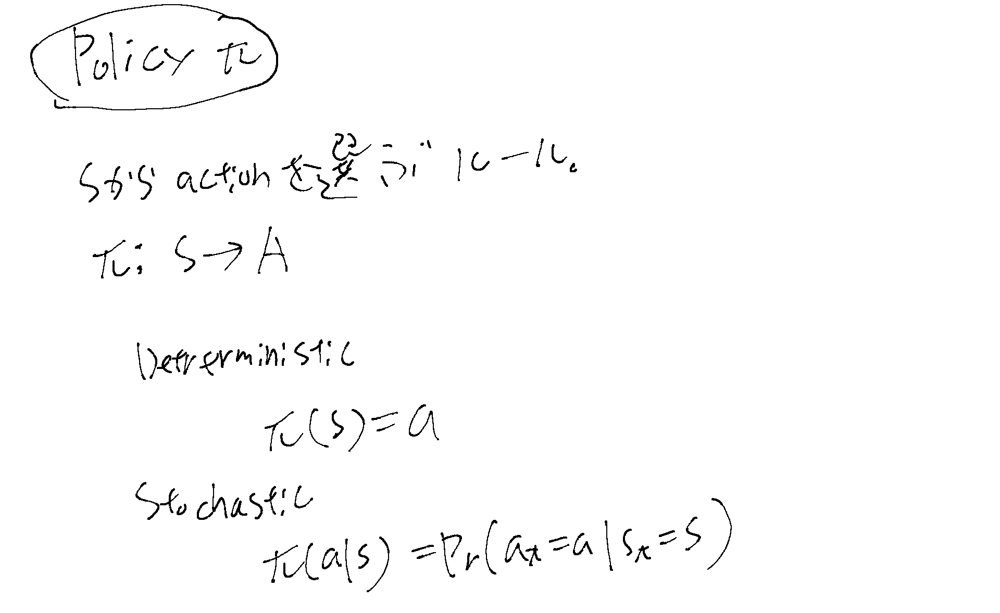
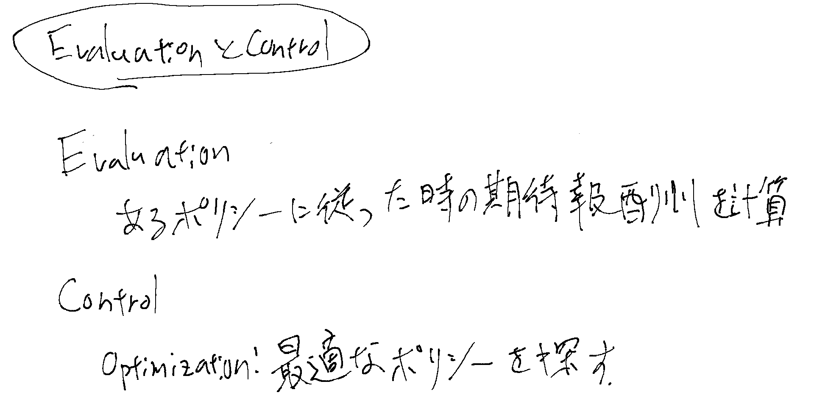

[[強化学習]]

[Stanford CS234 Reinforcement Learning I Introduction to Reinforcement Learning I 2024 I Lecture 1 - YouTube](https://www.youtube.com/watch?v=WsvFL-LjA6U) より。

## History、State、マルコフassumption

## Sequential Decision Process

## MDP (Markov Decision Process)

[[MarkovDecisionProcess]]

### Policy

### EvaluationとControl

## リターンとバリュー関数

[[リターンとバリュー関数]]

## モデル

強化学習では、Dynamicsとrewardsに関する数学モデルの事。