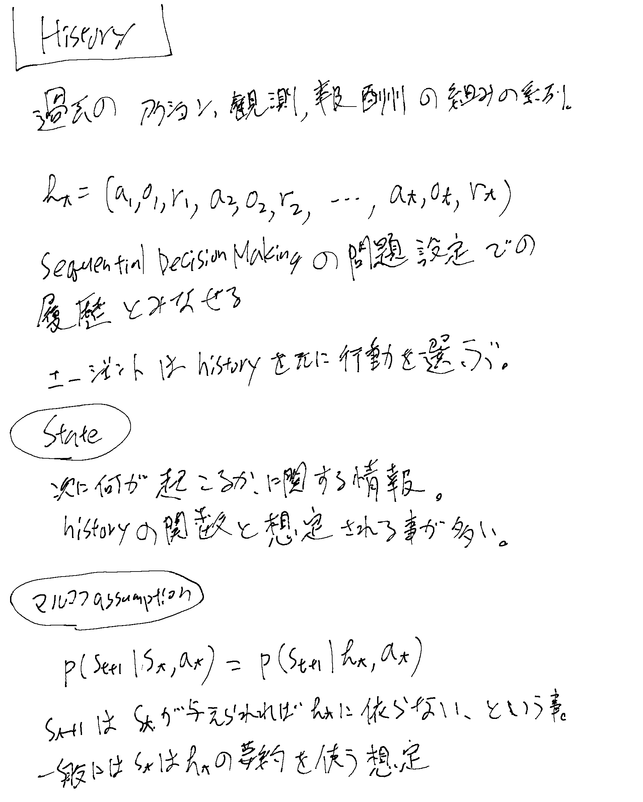
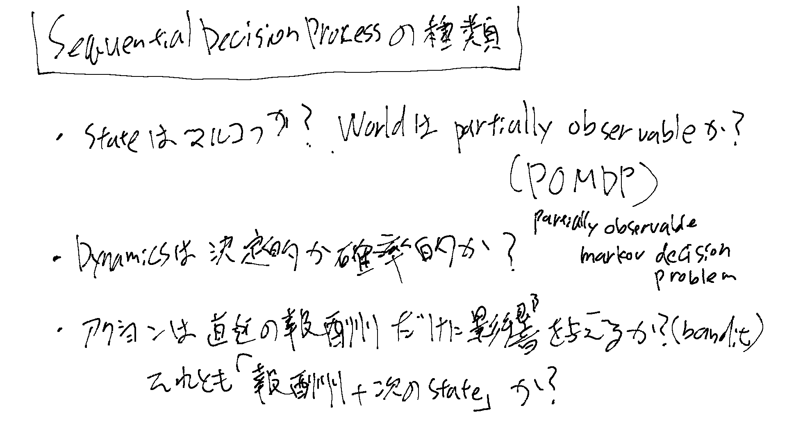
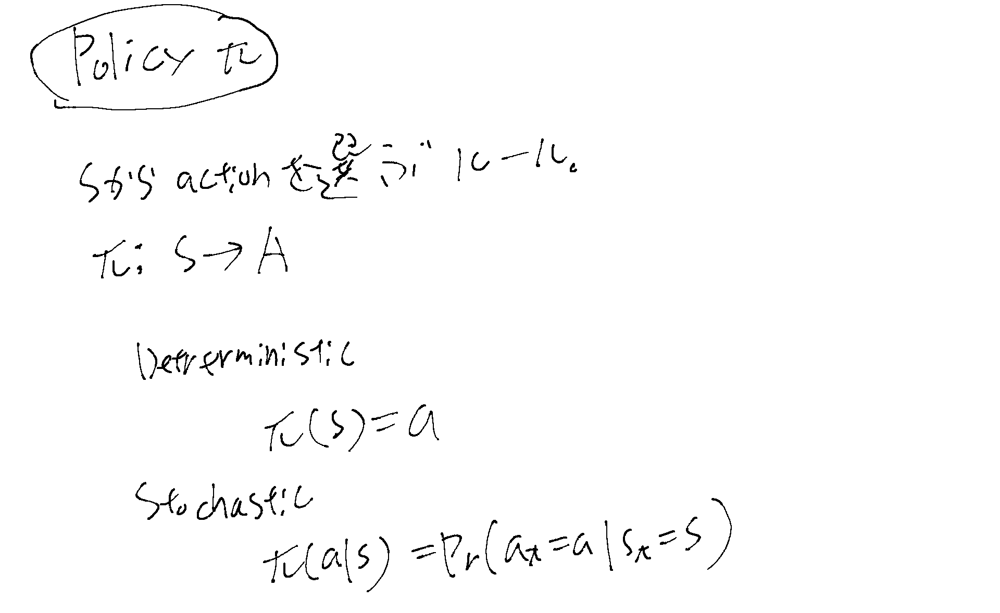
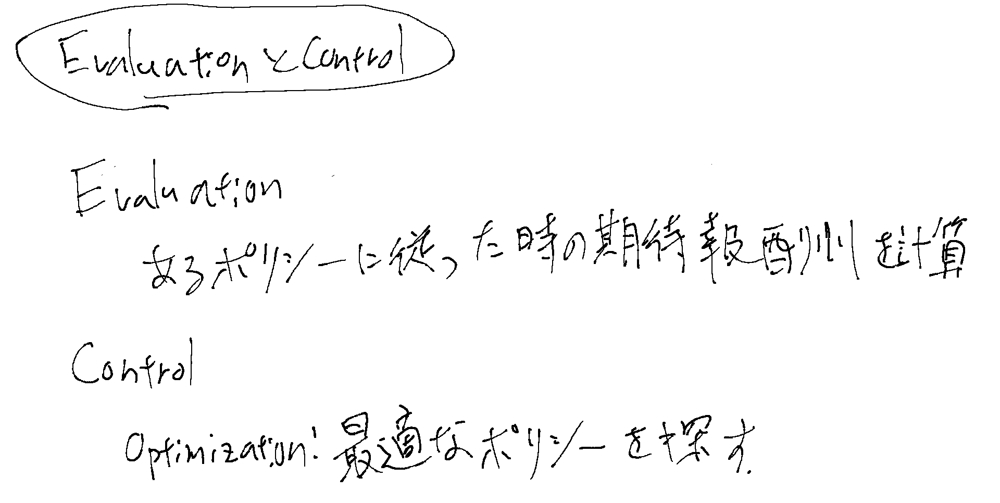

[[強化学習]]

[Stanford CS234 Reinforcement Learning I Introduction to Reinforcement Learning I 2024 I Lecture 1 - YouTube](https://www.youtube.com/watch?v=WsvFL-LjA6U) より。

## History、State、マルコフassumption

## Sequential Decision Process

## MDP (Markov Decision Process)

[[MarkovDecisionProcess]]

### Policy

### EvaluationとControl

## リターン関数、バリュー関数、Q関数

- [[リターン関数]] $G_t$で表記。tより先のリワードの割引現在価値の合計
- [[Value関数]] Vで表記。State-Value関数とも言う。
- [[Q関数]]  Qで表記。State-Action Value関数とも言う。

## モデル

強化学習では、Dynamicsとrewardsに関する数学モデルの事。

## ブートストラップ

[[TDLearning]]より。
ブートストラッピングは自分自身を足場に自分自身を引き上げる、というようなニュアンスで、Vの更新の時にその時点のV自身の予測値を使っている、というような意味らしい。（[[TDLearning]]の例ではV(A)を更新する時にその時点のV(B)を使ったりしている）

例えばTDLearningのTD(0)では、直近のrと、それ以後の割引リターンでVを更新する。割引リターンのところでV自身を使っているのがブートストラップ、と呼ばれる手法となる。