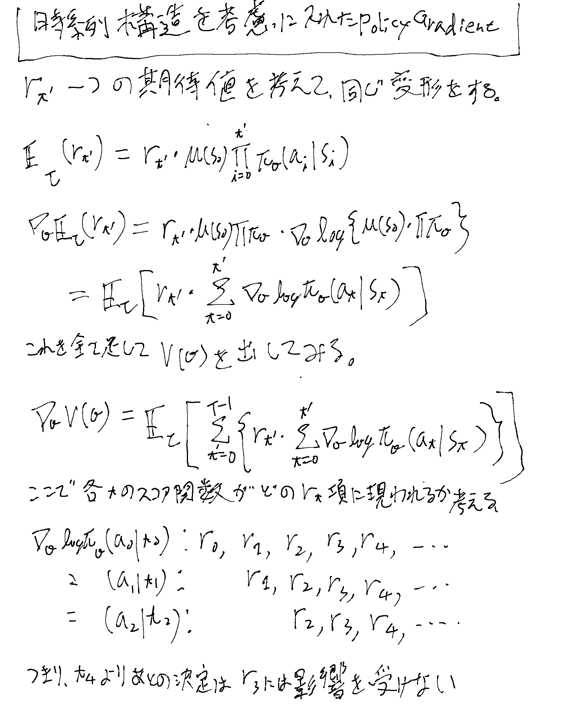
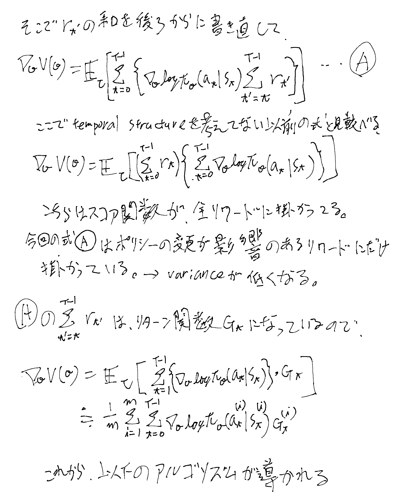
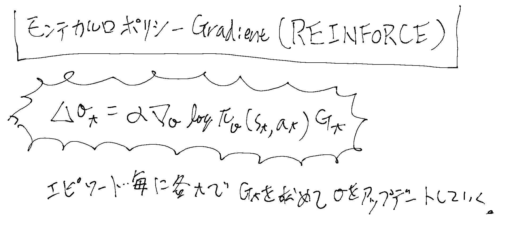
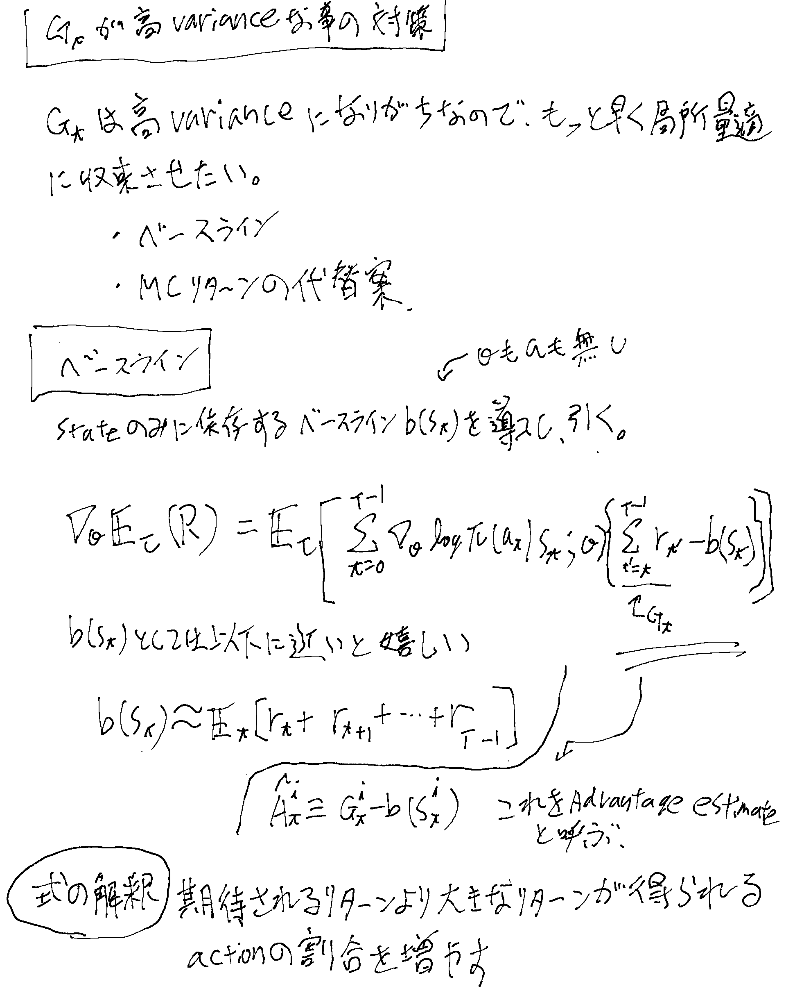
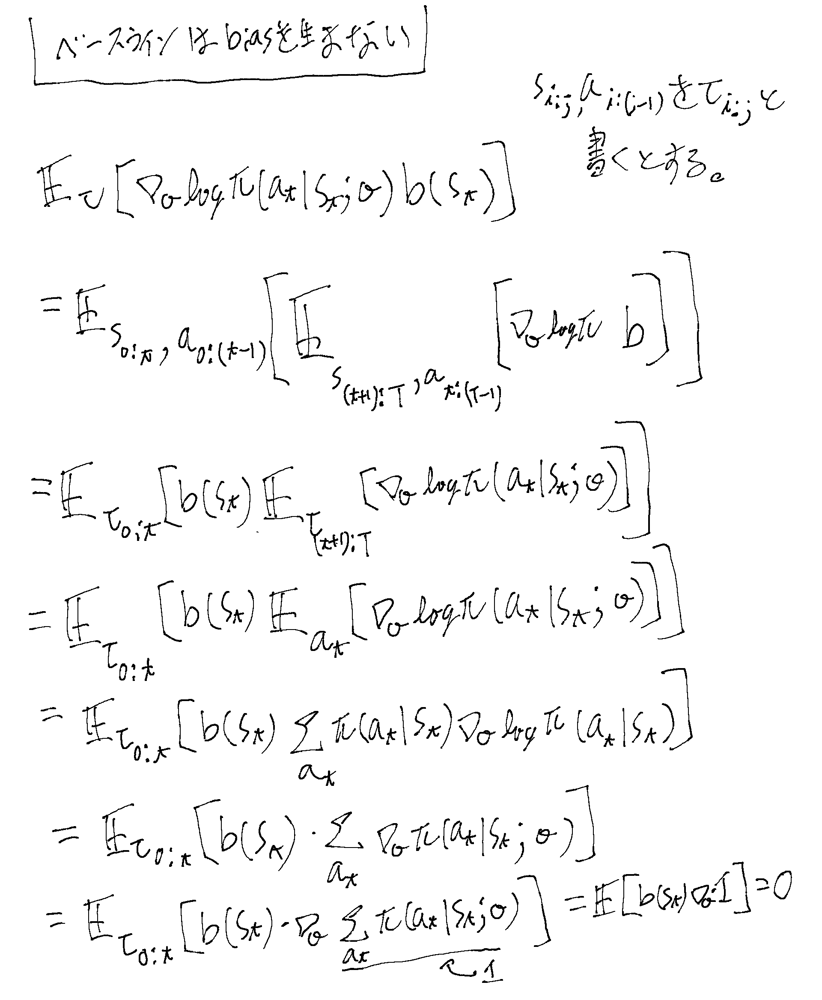
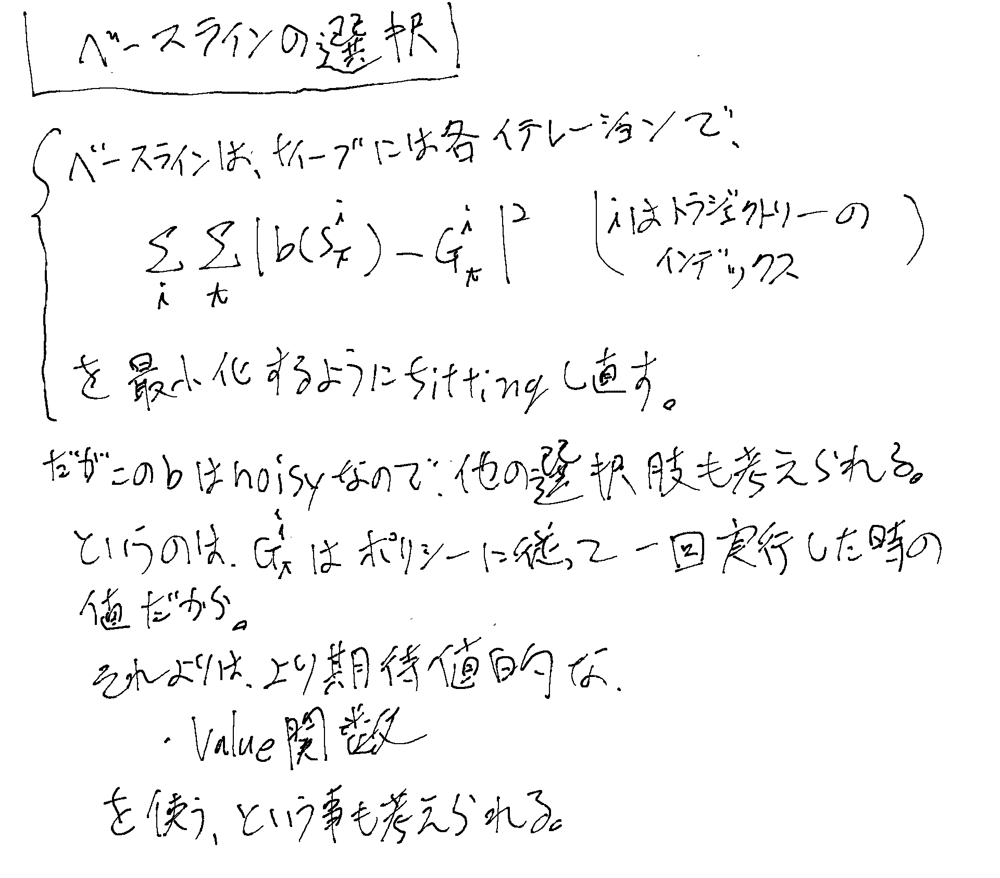
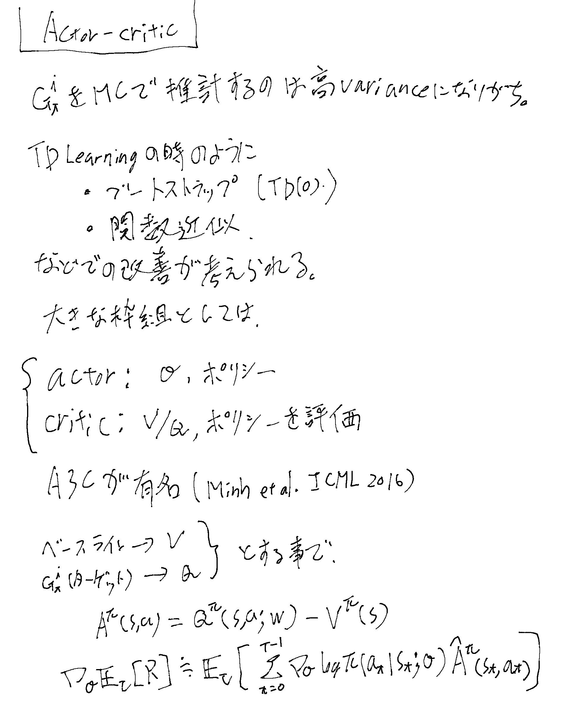
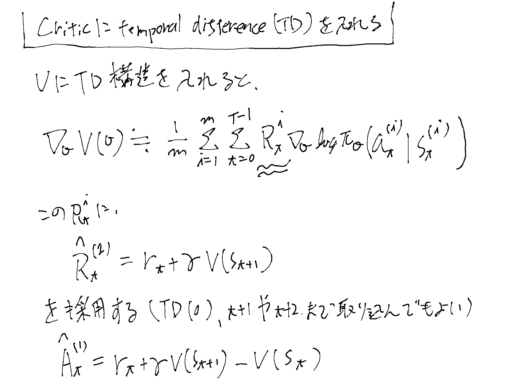

[[強化学習]]の[[PolicySearch]]の[[PolicyGradient]]法で、時系列構造を考慮に入れる事を考える。

[Stanford CS234 Reinforcement Learning I Policy Search 2 I 2024 I Lecture 6 - YouTube](https://www.youtube.com/watch?v=8PwvNQ5WS-o&list=PLoROMvodv4rN4wG6Nk6sNpTEbuOSosZdX&index=6)

## 時系列構造を考慮に入れたPolicy Grad（REINFORCE）

[[PolicyGradient]]でやったLikelihoodレシオなどを用いた計算では、時系列構造が考慮に入っていない。
時系列構造を考慮に入れてVのgradを計算してみる。

## REINFORCE(モンテカルロポリシーGradient）

### Gが高variantになる問題の二つの対策

Gはトラジェクトリー一つにつき一回計算する感じなので、varianceが高くなって収束までに大量のデータが必要となる。
この対策に二つの方法が考えられている。

- baseline
- MCリターンの代替を考える（Actor-Critic）

## baseline

### baselineはバイアスを生じさせない

### baselineの選択

## Actor-Critic

### CriticにTD構造を入れる

